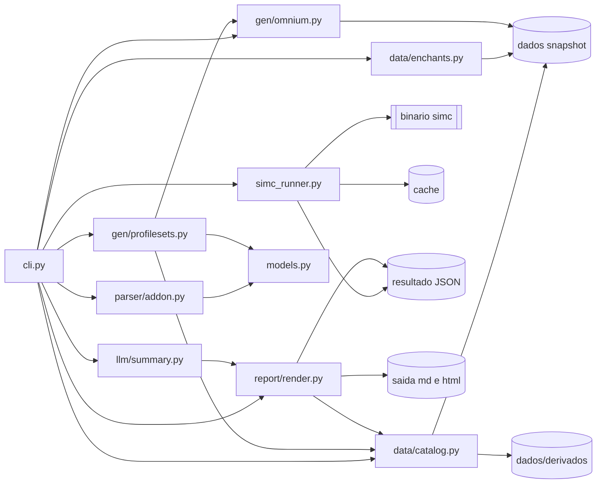
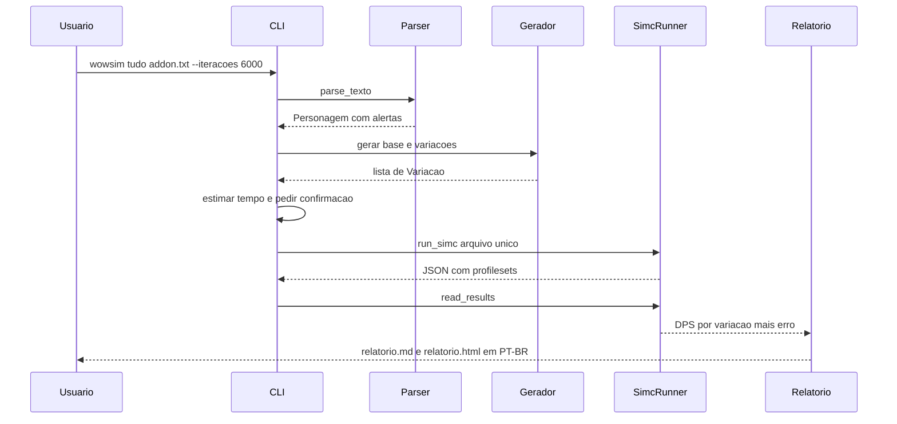
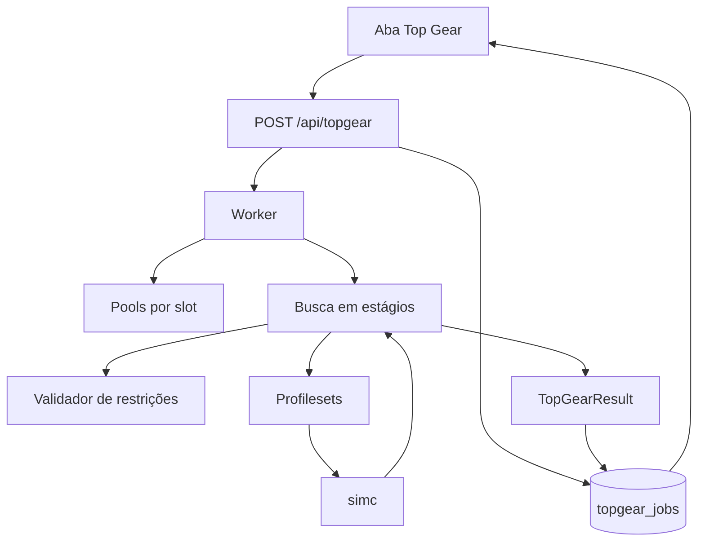

# Arquitetura — WoW Calculator Sim

**Projeto:** simulador local de equipamento para World of Warcraft: Midnight
**Patch de referência:** cliente 12.1.5, build `12.1.5.70783`. O build contém o conteúdo 12.1 (*The Curse of Ula'tek*) e a atualização 12.1.5 (*The Promise of Tomorrow*); ver [`VERIFICACAO-EXTERNA.md`](VERIFICACAO-EXTERNA.md)
**Fase:** 0 — arquitetura aprovada antes de qualquer código
**Idioma:** documentação e saída em PT-BR; código, comentários e nomes de variável em inglês

> Documento irmão: [`FONTES.md`](FONTES.md). Pendências abertas: [`../PENDENCIAS.md`](../PENDENCIAS.md).
> Regra de método herdada do projeto de dados: [`00-INSTRUCOES-IA.md`](../../WoW%20Calculator/00-INSTRUCOES-IA.md) — nenhum número de dano, peso ou ganho pode ser inventado.

---

## 1. Princípios não negociáveis

| # | Princípio | Consequência prática |
| :-: | :--- | :--- |
| P1 | **O SimulationCraft é a única fonte de número** | Todo DPS, ganho percentual e diferença vem de um JSON gerado pelo `simc`. O catálogo local só resolve nome, ID, origem, regra e track. |
| P2 | **Proveniência obrigatória** | Todo dado de catálogo carrega `fonte="<arquivo>.json"`. Relatório sem `fonte` é bug, não estilo. |
| P3 | **Falha explícita, nunca estimativa** | Dado ausente vira `null`, alerta de parse e registro em `PENDENCIAS.md`. Nunca preencher por inferência silenciosa. |
| P4 | **Sem LLM no caminho do cálculo** | Não há LLM no projeto: a DeepSeek foi removida em 2026-11-09; o resumo é determinístico, só com números medidos. |
| P5 | **Um arquivo `.simc` por execução** | A base do personagem e todas as variações viram um único arquivo com `profileset`. Isso reduz overhead de processo e mantém a comparação no mesmo RNG de cenário. |
| P6 | **Determinismo de dados** | O projeto lê um snapshot versionado em `dados/`, com hash. Não lê caminhos externos por padrão. |
| P7 | **Windows e Linux** | `pathlib`, `subprocess` com lista de argumentos, sem shell específico. Nenhum `os.system`, nenhum `rm -rf`. |
| P8 | **Espaço de nome único de variação** | O nome do profileset é a chave de junção com o resultado e com o relatório. Colisão é erro fatal, não desempate. |

---

## 2. Decisões arquiteturais

### ADR-001 — Projeto em `wow-sim/` com snapshot de dados

- **Decisão:** o código mora em `wow-sim/` na raiz do workspace. Os arquivos de dados usados são copiados para `wow-sim/dados/` a partir da raiz de [`WoW Calculator`](../../WoW%20Calculator), com `dados/MANIFEST.json` guardando `caminho_origem`, `sha256` e `copiado_em`.
- **Motivo:** o repositório de dados é externo, continua mudando e contém três cópias da mesma base. Ler direto por caminho relativo tornaria testes não determinísticos e ambíguos.
- **Alternativa descartada:** ler `../WoW Calculator` em tempo de execução. Descartada por quebrar em clone limpo e por não fixar qual cópia foi usada.
- **Override:** `WOWSIM_DADOS` aponta para outro diretório durante desenvolvimento. O loader nunca escreve no diretório apontado.
- **Drift:** `scripts/sincronizar_dados.py` compara hashes. Divergência gera aviso e entrada em `PENDENCIAS.md`; nunca sobrescreve em silêncio.

### ADR-002 — SimC como autoridade, catálogo como tradutor

- **Decisão:** se o catálogo divergir do `simc`, vale o `simc`, e a divergência é registrada.
- **Onde aparece:** `catalog.py` devolve `simulavel: bool` e `fonte`. Item fora de `item_data.inc` e sem nome oficial é marcado `simulavel=false` e não entra em geração de variação.
- **Exceção lógica:** o catálogo tem prioridade sobre o prompt quando o prompt repete erro já corrigido em [`pendencias.md`](../../WoW%20Calculator/pendencias.md:197) — por exemplo, nomes do Códice Corrosivo e a disputa Marca do Magíster × Marca da Alma do Mundo no torso.

### ADR-003 — `enchant_id` resolvido pelo mapeamento já auditado

- **Decisão:** `data/enchants.py` usa `dados/enchant_ids_s2.json` (97 IDs) como mapa primário `enchant_id → nome/tier/item_id`, e `encantamentos_e_gemas_s2.json` para a identidade PT-BR por `item_id`.
- **Fallback:** se o ID não existir no mapa, tentar `engine/dbc/generated/permanent_enchant.inc` do repositório do simc, se estiver disponível; senão, `nome=null` + pendência.
- **Motivo:** o projeto já pagou o custo de validar esse mapa contra o DB2. Fazer o caminho crítico depender de parse de `.inc` reintroduz risco sem ganho.
- **Regra de leitura:** `enchant_id` **não** é ID de pergaminho; é a linha de `SpellItemEnchantment`, uma por qualidade.

### ADR-004 — Folio Ômnico como dado declarado, não como inferência

- **Contexto de conflito:** o prompt afirma que `omnium_talents` contém as runas escolhidas, com tabela `1368xx`. [`import_e_interpretacao_s2.md`](../../WoW%20Calculator/import_e_interpretacao_s2.md:529) afirma que o campo traz apenas os cinco nós desbloqueados. [`pendencias.md`](../../WoW%20Calculator/pendencias.md:264) registra o personagem como `1A-2B-3A-4A-5B`, enquanto o exemplo do prompt decodifica `1A-2B-3A-4A-5A`.
- **Decisão:**
  1. O parser **preserva** os IDs brutos de `omnium_talents` e **não** assume que representam a escolha.
  2. `gen/omnium.py` resolve runas por duas famílias: `1368xx` (tabela fornecida no prompt) e `1279xxx`/`1287xxx` (nós e buffs de [`rune_ids_s2.json`](../../WoW%20Calculator/rune_ids_s2.json:47)).
  3. A seleção usada no relatório vem de `--runas` ou do campo `runas_atuais`; sem eles, a seleção inferida é marcada `confianca=baixa` e o relatório declara a limitação.
  4. Toda variação de Folio troca **uma entrada por vez**, dentro da mesma linha.
- **Critério de aceite do módulo:** a mesma seleção deve ser reproduzível a partir do código `Cxx` e dos IDs; a divergência `5A`/`5B` fica aberta em `PENDENCIAS.md` até existir um segundo export que a resolva.
- **Evidência de 2026-11-06:** o export real do Pyrogalth traz `136814:1/136815:1/136817:1/136819:1/136822:1`, exatamente um ID por linha. Sob a tabela do prompt isso dá `1A-2B-3A-4A-5A`. A documentação do projeto lista `136824` e conclui `C14` (`5B`), o que é incompatível com o export. O `omnium-talents.json` do Raidbots confirma que `1368xx` são entradas de escolha do nó `110271`. A partir da Fase 2, o valor bruto do export é a seleção padrão e `--runas` continua tendo precedência. Ver [`RAIDBOTS-REFERENCIA.md`](RAIDBOTS-REFERENCIA.md).

### ADR-005 — Variações por `profileset`, base sempre presente

- **Decisão:** `gen/profilesets.py` monta um arquivo com (a) o bloco do personagem sem a variável que muda e (b) uma linha `profileset."<nome>"+=<override>` por variação. A base é simulada como jogador principal.
- **Motivo:** um único `simc` por lote; o relatório compara cada profileset com a base no mesmo cenário.
- **Limite:** `--max-variacoes` padrão 40 e estimativa de tempo calculada a partir de uma execução curta de calibração, exibida antes de rodar.
- **Não fazer:** produto cartesiano completo de todas as categorias. Combos só sob demanda explícita.

### ADR-006 — Relatório determinístico é o produto; LLM é enfeite opcional

- **Decisão:** `report/render.py` produz `relatorio.md` e `relatorio.html` sem LLM. A Fase 6 adiciona `llm/summary.py` que recebe **somente** o JSON de resultados, com prompt restritivo e validação numérica pós-resposta.
- **Regra de empate:** diferença menor que `max(erro_base, erro_variacao, 0.15%)` é "empate técnico". Nenhuma recomendação de troca por ruído.

### ADR-007 — Fixture real é pré-requisito declarado

- **Decisão:** o projeto não reconstrói o export do Pyrogalth a partir de trechos documentados. O fixture oficial é a saída de `/simc` colada em `fixtures/pyrogalth.simc`.
- **Enquanto ausente:** testes de parser rodam com fixtures sintéticos marcados `sintetico=True`; `wowsim simc-check` falha com mensagem explícita e código de saída não zero. Nenhum valor de DPS é impresso sem execução real.

### ADR-008 — Cache de execução por hash de entrada

- **Decisão:** cada execução grava `cache/<sha256>.json` com o JSON bruto do simc, os parâmetros e a versão do binário. Reexecutar a mesma entrada devolve o cache, salvo `--forcar`.
- **Motivo:** cada variação custa caro; iterar no relatório não pode exigir retorno ao simc.

### ADR-009 — Contrato defensivo com o JSON do simc

- **Decisão:** `simc_runner.read_results()` é um adaptador, não um acesso direto a chaves. Ele lê `profilesets.results` e a base, aceita `median` com fallback para `mean`, e valida a presença dos campos esperados.
- **Motivo:** o schema do JSON varia entre builds. Um probe de schema roda na primeira execução e grava `dados/derivados/simc_schema.json`; campo ausente vira pendência, não `KeyError` no meio do relatório.

### ADR-010 — Sem escrita fora de `wow-sim/`

- **Decisão:** saídas em `saida/`, cache em `cache/`, derivados em `dados/derivados/`, tudo dentro do projeto e ignorado pelo Git quando efêmero.
- **Exceção:** atualização do snapshot de dados, feita por script explícito e revisada por diff.

### ADR-011 — Poda heurística antes do SimC (Caminho A)

- **Decisão:** antes de medir, o Top Gear e o Droptimizer pontuam os candidatos por atributos secundários (`heuristic/score.py` + `dados/pesos_secundarios.json`) e medem apenas os top-K por slot (`pool_efetiva_por_slot`, padrão 6). Berloques, armas, itens com efeito e itens sem stats nunca são podados.
- **Motivo:** medir todos os candidatos com o SimC deixava o produto "igual ao Raidbots, porém mais lento". A heurística poda barato (estilo AMR) e o SimC confirma só os finalistas — a complementaridade pretendida.
- **Regra preservada:** o score é sempre `heuristico=True` e **nunca** é DPS; o número final vem do SimC (P1).
- **Verificação:** `verificar_podados=True` re-mede os descartados ao final e recupera ganho perdido, avisando para aumentar K.
- **Transparência:** a rodada registra `estagio="poda"` com a contagem descartada e um aviso com a fonte dos pesos.
- **Evolução:** pesos medidos via `calculate_scale_factors` do SimC substituem os curados quando disponíveis. Implementado em `data/pesos_medidos.py` + `scripts/derivar_pesos.py`; a poda usa o cache medido automaticamente quando existir.

---

## 3. Diagrama de módulos



---

## 4. Estrutura de pastas

```text
wow-sim/
  pyproject.toml
  README.md
  PENDENCIAS.md
  docs/
    ARQUITETURA.md
    FONTES.md
  dados/
    MANIFEST.json
    <snapshot dos JSON e MD usados>
    derivados/
      bonus_ilvl.json
      nomes_itens.json
      simc_schema.json
  fixtures/
    pyrogalth.simc
    sinteticos/
  scripts/
    build_simc.sh
    build_simc.ps1
    sincronizar_dados.py
  src/wowsim/
    __init__.py
    cli.py
    models.py
    pendencias.py
    simc_runner.py
    parser/addon.py
    data/catalog.py
    data/enchants.py
    gen/profilesets.py
    gen/omnium.py
    report/render.py
    report/templates/relatorio.md.j2
    report/templates/relatorio.html.j2
    llm/summary.py
  tests/
```

---

## 5. Modelo de dados

Modelos em `pydantic v2`, todos com `model_config = ConfigDict(extra="forbid")` para impedir campo inventado por engano.

```python
class AlertaParse(BaseModel):
    codigo: str                     # ex: omnium_incompleto, slot_sem_id, checksum_ausente
    severidade: Literal["info", "aviso", "bloqueio"]
    detalhe: str
    linha: int | None


class ItemEquipado(BaseModel):
    slot: str
    item_id: int | None
    enchant_id: int | None
    gem_ids: list[int]              # vazio quando não há gema
    bonus_ids: list[int]
    crafted_stats: tuple[int, int] | None
    crafting_quality: int | None
    content_tuning: int | None
    drop_level: int | None
    redirected_base_stats: int | None
    ilvl_comentario: int | None
    nome_pt: str | None
    nome_en: str | None
    origem_linha: Literal["equipado", "mochila", "catalogo"]
    linha_original: str


class MarcaIlvl(BaseModel):
    indice: int
    ilvl_atual: int
    ilvl_maximo: int
    mapeado: bool = False           # falso enquanto o índice não for identificado


class Personagem(BaseModel):
    nome: str | None
    classe: str | None
    spec: str | None
    nivel: int | None
    raca: str | None
    regiao: str | None
    servidor: str | None
    profissoes: dict[str, int]
    talents_atual: str | None
    loadouts: dict[str, str]        # nome -> import string, descomentado
    omnium_ids_brutos: list[int]
    runas_declaradas: dict[str, str] | None
    equipado: dict[str, ItemEquipado]
    mochila: dict[str, list[ItemEquipado]]
    catalyst_currencies: dict[int, int]
    upgrade_currencies: dict[str, int]
    slot_high_watermarks: list[MarcaIlvl]
    bonus_roll_currencies: dict[int, int]
    checksum: str | None
    versao_addon: str | None
    linhas_originais: list[str]
    alertas: list[AlertaParse]


class NomeItem(BaseModel):
    item_id: int
    nome_pt: str | None
    nome_en: str | None
    fonte: str
    simulavel: bool


class IlvlBonus(BaseModel):
    bonus_id: int
    trilha: str | None
    rank: str | None
    ilvl: int | None
    evidencia: str | None           # simc, tooltip ou catalogo
    fonte: str


class RunasFolio(BaseModel):
    codigo: str | None              # 1A-2B-3A-4A-5A
    por_linha: dict[str, str]
    ids_por_linha: dict[str, list[int]]
    confianca: Literal["alta", "media", "baixa"]
    fonte: str


class Variacao(BaseModel):
    nome: str                       # prefixo de categoria + detalhe, unico
    categoria: Literal["base", "upgrade", "item", "encanto", "gema", "talento", "folio", "berloque", "combo"]
    linhas_override: list[str]
    item_ids: list[int]
    bonus_ids_envolvidos: list[int]
    fonte: str


class ResultadoVariacao(BaseModel):
    nome: str
    dps: float
    erro_pct: float | None
    amostras: int | None
    eh_base: bool


class LinhaRelatorio(BaseModel):
    variacao: str
    categoria: str
    dps: float
    delta_pct: float | None
    erro_pct: float | None
    veredito: Literal["ganho", "perda", "empate", "nao_simulavel"]
    nome_pt: str | None
    nome_en: str | None
    item_id: int | None
    fonte: str
```

**Regras de validação**
- `Variacao.linhas_override` nunca vazio; `nome` bate com `^[a-z0-9_]+$`.
- `ItemEquipado.enchant_id` só é preenchido em slots que aceitam encantamento: cabeça, ombros, peitoral, pés, os dois anéis e arma. Pernas usam Magilinha ou Kit, tratados como camada separada.
- `Personagem.loadouts` guarda a import string **sem** o `#`; a serialização decide o comentário.
- `ResultadoVariacao.erro_pct` é `null` quando o simc não devolver erro; o relatório usa então o piso de 0,15%.
- `MarcaIlvl.mapeado` falso por padrão: só o índice 14 tem leitura autorizada pelo projeto.

---

## 6. Contratos entre módulos

| Módulo | Função pública | Entrada | Saída | Erros esperados |
| :--- | :--- | :--- | :--- | :--- |
| `simc_runner` | `find_simc()` | nenhuma | `Path` do binário | `SimcNaoEncontrado` com instruções de download e compilação |
| `simc_runner` | `check_version(bin)` | binário | `SimcInfo` com versão, build e branch | `SimcIncompativel` quando build diverge do addon |
| `simc_runner` | `run_simc(...)` | arquivo `.simc`, iterações, `fight_style`, threads, `target_error`, `desired_targets` | `SimcExecucao` com caminho do JSON e stdout | `SimcFalhou` com exit code e últimas linhas |
| `simc_runner` | `read_results(json_path)` | JSON do simc | lista de `ResultadoVariacao` mais metadados | `SchemaSimcDesconhecido` |
| `parser/addon` | `parse_texto(texto)` | texto do addon | `Personagem` | `FormatoAmrRejeitado`, `FormatoDesconhecido` |
| `parser/addon` | `serializar_equipamento(p)` | `Personagem` | bloco de slots byte a byte | `ErroRoundTrip` |
| `data/catalog` | `nome_item(id)` | item id | `NomeItem` com `fonte` | nunca lança; devolve `null` marcado |
| `data/catalog` | `bonus_para_ilvl(id)` | bonus id | `IlvlBonus` | devolve `ilvl=None` quando não validado |
| `data/enchants` | `resolver(enchant_id)` | id do export | nome PT-BR, nome EN, tier, `fonte` | devolve `null` e alerta |
| `gen/omnium` | `selecao_atual(p)` | `Personagem` | `RunasFolio` com confiança | `RunasIndisponiveis` |
| `gen/profilesets` | `gerar(...)` | `Personagem`, catálogo, opções | `list[Variacao]` e texto do arquivo | `SemVariacoesSimulaveis` |
| `report/render` | `render(...)` | resultados, personagem, catálogo | caminhos de `.md` e `.html` | `RelatorioIncompleto` |
| `llm/summary` | `resumir(...)` | JSON de resultados | texto validado ou `None` | nunca derruba o fluxo |

**Contrato de proveniência:** todo objeto vindo de `data/` expõe `fonte` com o nome do arquivo. `report/render` falha em teste se alguma linha de catálogo sair sem `fonte`.

---

## 7. Pipeline de execução



Fluxo de decisão do relatório: base simulada é a referência; cada variação é comparada à base; empate quando a diferença absoluta é menor que o maior erro disponível, com piso de 0,15%; a coluna `fonte` acompanha toda linha que cite item, encantamento, gema, runa ou origem.

---

## 8. Leitura do JSON do SimC

1. Localizar a base em `sim.players[0].collected_data` e os profilesets em `sim.profilesets.results`.
2. Para cada entrada, usar `median` quando existir; senão `mean`. Guardar `mean_std_dev` ou `median_std_dev` como erro.
3. Converter erro para percentual: `erro_pct = 100 * erro_abs / dps`.
4. Nomear a base como `base` no modelo interno; não depender do nome que o simc dá ao jogador principal.
5. Gravar um retrato do schema na primeira execução (`dados/derivados/simc_schema.json`) para detectar mudança de build.
6. Nunca usar `json2=` vazio: o caminho do arquivo é sempre gerado em `cache/` com nome único.

**Campos a confirmar na primeira execução real** — a Fase 1 fecha isso e registra o resultado: chaves exatas de erro em `profilesets.results`, presença de `median`, e formato de `collected_data.dps` no jogador principal.

---

## 9. Estratégia de testes

| Marcador | O que cobre | Precisa de simc | Precisa do fixture real |
| :--- | :--- | :-: | :-: |
| `unit` | modelos, catálogo, resolução de encantamento, geradores, cálculo de empate | não | não |
| `golden` | round-trip do parser e extração de loadouts, omnium e marcas | não | sim |
| `integration_simc` | `simc-check`, geração com 200 iterações, leitura de `profilesets.results` | sim | sim |
| `schema` | contrato do JSON do simc e do snapshot de dados | não | não |

Regras:
- Teste que depende de dado ausente deve **falhar com mensagem acionável**, não pular silenciosamente.
- Fixtures sintéticos vivem em `fixtures/sinteticos/` e todo teste que os usa declara `sintetico=True`.
- Contagens do catálogo viram teste: 38 encantamentos em 76 IDs, 72 gemas, 6 aprimoramentos de perna em 12 IDs, 13 runas e 72 combinações.
- Teste de proveniência: nenhuma linha de relatório sem `fonte`.

---

## 10. Riscos

| # | Risco | Impacto | Mitigação |
| :-: | :--- | :--- | :--- |
| R1 | Fixture real do Pyrogalth não existe | Bloqueia Fases 1, 2 e 5 | Solicitar export `/simc`; testes sintéticos enquanto isso; falha explícita |
| R2 | Binário do simc ausente ou de build diferente | Números inválidos para o patch | `find_simc`, `check_version`, comparação com `12.1.5.70783`, aviso no relatório |
| R3 | `omnium_talents` ambíguo entre prompt, spec e pendências | Variações de Folio sobre seleção errada | ADR-004, `--runas`, confiança declarada, pendência aberta |
| R4 | `bonus_id` de rank intermediário sem ilvl catalogado | Upgrade simulado para nível errado | Derivar por execução do simc e cachear; `null` + pendência sem isso |
| R5 | `slot_high_watermarks` com índices não mapeados | Sugestão de Brasão em slot errado | Usar somente índice 14; demais como informativo |
| R6 | Schema de `profilesets.results` muda entre builds | Relatório quebrado | Adaptador com fallback e probe de schema |
| R7 | Código de import de talentos não é decodificado | Comparação de talento só por loadout salvo | Usar somente loadouts nomeados; declarar limitação |
| R8 | Berloques on-use dividem recarga no jogo | Recomendação inválida com dois on-use | Gerador marca pares on-use + on-use como `nao_simulavel` e alerta regra R4 |
| R9 | APL padrão subestima Ceifador de Almas | Comparação injusta de talentos | Aviso fixo no relatório para loadouts de Soul Harvester |
| R10 | Códice Corrosivo e sobrevivência fora do simc | Falsa impressão de cobertura | Seção Limites obrigatória no relatório |
| R11 | Custo de CPU em máquina de 2 núcleos | Execuções longas e aparente travamento | Estimativa antes de rodar, `threads = nucleos - 1`, cache por hash |
| R12 | Dados de origem com duplicatas e erratas | Nome ou número errado propagado | Snapshot só da raiz, `fonte` obrigatório, erratas lidas antes |
| R13 | LLM inventa número no resumo | Relatório mente | Validação numérica, descarte e fallback determinístico |
| R14 | Item fora do banco do simc | Variação que nunca simula | `simulavel=false` e exclusão com aviso |

---

## 11. Critérios de aceite por fase

| Fase | Aceite |
| :-: | :--- |
| 0 | Este documento e [`FONTES.md`](FONTES.md) aprovados pelo usuário |
| 1 | `wowsim simc-check` roda o fixture e imprime DPS base dentro de ±3% dos valores de referência |
| 2 | Round-trip do bloco de equipamento byte a byte, 6 ou mais loadouts extraídos, 5 runas lidas |
| 3 | Contagens de catálogo conferidas; todo item sem `simulavel` identificado; toda saída com `fonte` |
| 4 | Arquivo gerado com todas as variações, cada uma presente no resultado do simc |
| 5 | Relatório PT-BR com empate por erro, Onde dropa e Limites; cenário de anéis e berloques confere |
| 6 | Resumo opcional nunca introduz número fora do JSON; `--sem-llm` sempre funciona |
| 7 | Só se solicitado; sem login, concorrência igual a núcleos menos um |
| 8 | `wowsim topgear` e `/api/topgear` produzem melhor conjunto medido dentro do orçamento, sem violar restrições; suíte verde |

---

## 12. Fora de escopo declarado

- Simular Códice Corrosivo, sobrevivência, dano recebido e efeitos defensivos.
- Decodificar import string de talentos por nó.
- Ler API da Blizzard, armory ou AMR.
- Interpretar `slot_high_watermarks` além do índice 14 enquanto o mapa não for fechado.
- Inventar nome PT-BR para item ausente do catálogo; nesse caso o relatório mostra o inglês com marca "PT a confirmar".

---

## 13. Pendências iniciais

Ver [`../PENDENCIAS.md`](../PENDENCIAS.md). As bloqueantes para começar a Fase 1 são: ausência do fixture real e ausência de binário do simc com build compatível.

---

## 14. Top Gear — busca em estágios (fase 8)

Módulos: `topgear/models.py`, `topgear/pools.py`, `topgear/constraints.py`, `topgear/search.py`, `topgear/runner.py`, `web/topgear_db.py`, `web/topgear_worker.py`, `web/topgear_api.py` e a aba React `TopGearPanel`.



- **Regra de ouro mantida:** todo DPS vem do `simc`; pools e validador apenas reduzem o espaço de busca. Empate por erro com piso de 0,15%.
- **Estágios:** marginal, gulosa, beam de 2 slots, encantos, gemas, talentos (loadouts validados), Folio e refino. `slots_travados`, orçamento e cancelamento são respeitados entre lotes.
- **Persistência:** `topgear_jobs` guarda request, progresso, estado e resultado. Jobs `pending`/`running` são reenfileirados no próximo início (retomada simples, reiniciando a busca a partir da base).
- **Gate de dados:** `data/gate.py` + `scripts/atualizar_dados.py` bloqueiam qualquer snapshot com contagem, bônus, nome, patch ou hash divergente.
- **Limites declarados:** combinações de talentos usam loadouts validados; a otimização de gemas troca a gema principal de cada soquete; o refino usa o mesmo conjunto vencedor com mais iterações.
