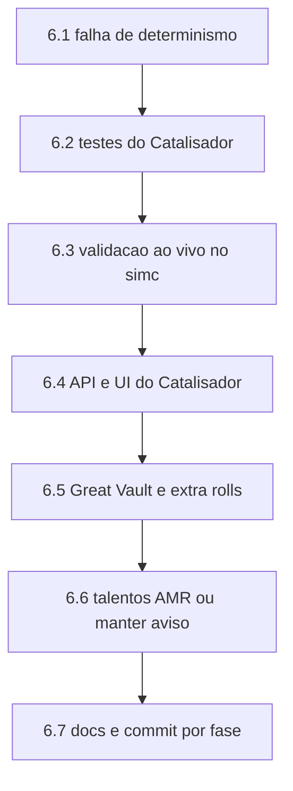

# Plano de Continuidade — Catalisador, Great Vault e Talentos AMR

**Criado em:** 2026-11-08
**Para quem:** qualquer agente de IA ou desenvolvedor que **assuma o trabalho no meio**.
**Por que existe:** registrar visão, arquitetura, estado exato do código e o passo a passo
restante, de modo que a continuação não precise redescobrir nada nem refazer decisões.

> Leia as seções 1 a 4 antes de escrever qualquer linha. Elas contêm as regras que,
> se quebradas, invalidam o produto inteiro.

---

## 1. A visão do produto (palavras do usuário)

> "Um sistema que unificasse de forma complementar as strings do SimC e do AMR, que fosse
> independente e gratuito, e que servisse de simulador mais robusto que o AMR e o SimC,
> para eu fazer o **loadout completo** e o sistema calcular. Hoje nenhuma das duas
> plataformas faz o loadout completo com runas de Omnium Folio, Top Gear exclusivo de M+,
> Great Vault e extra rolls, **excluindo drops de raide**, mas considerando itens Míticos
> de qualquer parte para eu transformar em tier set via Catalisador, e que também
> comparasse possíveis árvores de talentos de maneira unificada."

Diferenciais frente ao Raidbots (que é a referência de mercado): roda local e sem fila,
tem estimativa instantânea por heurística, é PT-BR, lê SimC **e** AMR juntos, e explica a
decisão de cada troca.

### Escopo recortado (decisões já tomadas, não reabrir sem o usuário)

| Item | Decisão | Motivo |
| :--- | :--- | :--- |
| **Códice Corroído** | **Fora de escopo** | O SimC não modela esse sistema (busca em `simc-midnight/engine` por `corrosive` só acha o truque dos Vulpera). O usuário confirmou que "só funciona em Delve e mundo aberto". Sem modelo no SimC, qualquer número seria estimativa — proibido pela regra P1. |
| **Drops de raide** | Excluídos das pools | Pedido explícito: progressão No-Raid. As pools vêm de M+, Delve e craft. |
| **Simulador em GPU** | Arquivado | [`estudo-viabilidade-sim-gpu.md`](../../plans/estudo-viabilidade-sim-gpu.md) estima 5x a 32x, mas exigiria reimplementar o motor do SimC. Custo altíssimo, ganho não medido. |
| **"Todas" as árvores de talento** | Comparar um conjunto de candidatas | Testar o espaço completo é inviável e nenhum simulador faz. Valem os loadouts salvos no export + import strings extras. |

---

## 2. Invariantes do projeto (quebrar isto é bug grave)

1. **P1 — Só o SimulationCraft produz número.** Nenhum DPS pode vir de estimativa, de
   fórmula própria ou de LLM. A heurística de poda ([`heuristic/score.py`](../src/wowsim/heuristic/score.py:1))
   devolve *score*, nunca dano, e carrega `heuristico=True`.
2. **Sem inventar dado de jogo.** Nome, ilvl, `bonus_id`, `enchant_id` e regra de sistema
   saem de arquivo auditado em `dados/` ou do próprio `item_data.inc` do SimC. Tradução
   PT-BR "de cabeça" é proibida (pendência P-006 existe exatamente por isso).
3. **Toda pendência tem condição de fechamento.** Ver o padrão em
   [`PENDENCIAS.md`](../PENDENCIAS.md).
4. **Quebra de linha CRLF.** Os arquivos do repositório são Windows (CRLF). Script que
   reescreve arquivo **deve preservar** isso, senão o diff vira centenas de linhas falsas.
   (Aconteceu nesta sessão: 3.353 linhas de diff para 169 de mudança real.)
5. **Código e comentários em PT-BR** nas partes novas, seguindo o estilo já existente
   (docstrings explicam o *porquê*, não o *o quê*).
6. **Idioma do usuário é PT-BR.**

---

## 3. Arquitetura atual (mapa de 30 segundos)

```
C:\Users\carlo\Desktop\
├── Crawl4AI\                 scraper Wowhead (Crawl4AI + Streamlit + MCP)
│                             → github.com/carlosfylho-hub/Crawl4AI-WoW-Scraper (main)
└── Simulador WoW\
    ├── simc-midnight\        FONTE do SimulationCraft (build 12.1.5.70783) — 1,3 GB
    ├── wow-sim\              BACKEND Python: motor numérico  (~11,7k linhas + 4,9k testes)
    │                         → github.com/carlosfylho-hub/WoW-Simulator (master)
    ├── Simulator-WoW\        FRONTEND React 19 + Vite + Tailwind (~13k linhas TS)
    │                         → github.com/carlosfylho-hub/Simulator-WoW (main)
    └── plans\                auditorias e planos (este arquivo)
```

Um único processo serve tudo: o FastAPI do `wow-sim` serve o `dist/` do React e expõe a
API; `wowsim app` abre isso numa janela pywebview. Detalhe em
[`plano-unificacao-python-react.md`](../../plans/plano-unificacao-python-react.md).

### O caminho de um pedido de Top Gear

```
UI (TopGearPanel.tsx)
  → POST /api/topgear            (web/topgear_api.py)
  → fila SQLite                  (web/topgear_db.py)
  → worker                       (web/topgear_worker.py)
      ├── combinar_textos()      (parser/combinar.py)   SimC + AMR
      ├── construir_pools()      (topgear/pools.py)     candidatos por slot
      ├── construir_contexto()   (topgear/pools.py)     regras da spec
      └── executar_topgear()     (topgear/search.py)    busca em estágios
            └── criar_simulador()(topgear/runner.py)    .simc + profilesets
                  └── run_simc() (simc_runner.py)       binário real + cache
```

**Busca em estágios** (nunca produto cartesiano): poda heurística → varredura marginal →
montagem gulosa → **catalisador** → beam de 2 slots → encantos → gemas → talentos → Folio
→ consumíveis → refino com mais iterações. Cada etapa só aceita ganho acima do limiar de
erro (0,15%).

---

## 4. Como o Catalisador foi modelado (a ideia central)

Regra de jogo, registrada em `dados/season2_context.json`: o Catalisador converte uma peça
de armadura de **slot de tier** (cabeça, ombros, torso, mãos, pernas) na peça
correspondente do tier set do spec, **preservando trilha, nível de aprimoramento e stats
base** do item original.

No SimC isso se escreve exatamente como o addon já exporta uma peça catalisada:

```
head=,id=<ID_DA_PECA_DE_TIER>,bonus_id=<os mesmos do item original>,redirected_base_stats=<ID_DO_ITEM_ORIGINAL>
```

Confirmado na fonte: `redirected_base_stats` é parseado em
`simc-midnight/engine/item/item.cpp:875` e aplicado em
`engine/dbc/sc_item_data.cpp:1076` (o item de origem entra como `redirect_item` em
`parsed.data.init`). O bônus de 2/4 peças o SimC calcula sozinho a partir do `id_set` do
item equipado — **não existe** nada para implementar ali.

**Por que duas mecânicas e não uma:** o valor do tier vem do bônus de conjunto, que só
aparece com 2 ou 4 peças. A busca gulosa troca **um** slot por vez, então para quem tem 0
ou 1 peça de tier nenhuma troca isolada mostra ganho. Daí:

* **gêmeos catalisados** na pool — cada candidato de slot de tier ganha a versão
  catalisada, medida no contexto atual (resolve "falta 1 peça para o 2pc/4pc");
* **pacotes** — combinações de 2 e 4 peças a partir do melhor conjunto (resolve "tenho 0
  ou 1 peça"), onde nenhuma troca isolada apareceria.

---

## 5. Estado do código AGORA (o que já está feito)

Trabalho desta sessão, **ainda sem commit**. `git diff --stat --ignore-cr-at-eol` deve
mostrar **169 inserções e 10 remoções** em 7 arquivos, mais 4 arquivos novos. Se mostrar
muito mais, as quebras de linha foram corrompidas (ver invariante 4).

### Arquivos novos

| Arquivo | O que é |
| :--- | :--- |
| [`scripts/derivar_tier_sets.py`](../scripts/derivar_tier_sets.py:1) | Deriva as 5 peças de tier de cada classe lendo `id_set`, `class_mask` e `inventory_type` do `item_data.inc` do SimC. Regra: conjunto de 5 peças, qualidade Épica, máscara de classe única, de maior `item_id`. |
| `dados/derivados/tier_sets.json` | Saída do script. **13 classes** (set 2055 a 2067). Ex.: warlock = set 2066, head 271546, shoulder 271544, chest 271549, hands 271547, legs 271545 — confere com o fixture do Pyrogalth. |
| [`src/wowsim/data/tier.py`](../src/wowsim/data/tier.py:1) | Leitor com cache: `ConjuntoTier`, `normalizar_classe`, `conjunto_da_classe`, `ids_tier`, `disponivel`. Arquivo ausente ⇒ `{}` e o recurso simplesmente não liga. |
| [`src/wowsim/topgear/catalisador.py`](../src/wowsim/topgear/catalisador.py:1) | `gemeo_catalisado`, `adicionar_gemeos`, `pecas_de_tier`, `contexto_com_catalisador`, `pacotes_de_tier`. |

### Alterações em arquivos existentes

| Arquivo | Mudança |
| :--- | :--- |
`topgear/models.py` | `Candidato.redirected_base_stats` + propriedade `.catalisado`; `Estagio` ganhou `"catalisador"`; `TopGearRequest.catalisador` (bool, default **False**) e `.max_catalisados` (0–5, `None` = sem limite); `ContextoSpec.max_catalisados` e `.catalisados_equipados`.
`topgear/runner.py` | `_linha_item` emite `redirected_base_stats=` quando presente.
`topgear/search.py` | **(a) correção de bug:** `conjunto_do_personagem` passou a preservar `item.redirected_base_stats` — sem isso, toda peça **já catalisada** do personagem perdia os stats base ao ser reescrita, afetando Top Gear **e Droptimizer** (que importa a mesma função); **(b)** `_chave_conjunto` inclui o campo; **(c)** nova etapa `otimizar_catalisador`; **(d)** ligação em `executar_topgear` (gêmeos na pool + contexto + etapa na lista).
`topgear/pools.py` | `_chave` de deduplicação inclui `redirected_base_stats` (senão o gêmeo colidiria com o original).
`topgear/constraints.py` | `_erros_catalisador` (teto de cargas) entra em `validar`; `avisos` passa a relatar quantas conversões o conjunto usa, em quais slots, e explicita a premissa da regra.
`heuristic/score.py` | chave do `_dedupe` inclui `redirected_base_stats`.
`cli.py` | `wowsim topgear --catalisador` e `--max-catalisados N`.

### Verificações já feitas

* `import wowsim.topgear.search` e `import wowsim.topgear.catalisador` — OK.
* `tier.conjunto_da_classe('Warlock')` → set 2066 com os 5 ids corretos; `'death-knight'`
  normaliza; classe desconhecida → `None`.
* Subconjunto da suíte (constraints, pools, search, heuristic) rodou **62 passed, 1
  failed** — a falha é `test_topgear_search.py::test_busca_e_deterministica` e é
  **anterior** a estas mudanças (ver seção 6.1).

---

## 6. O que falta — passo a passo

### 6.1 Falha pré-existente de determinismo (P0, investigar antes de prosseguir)

`tests/test_topgear_search.py::test_busca_e_deterministica` compara duas execuções e
acusa diferença **só em `rodadas`** (os conjuntos e o DPS batem). Suspeita: ordem de
iteração ou contagem de candidatos variando entre execuções, o que muda `Rodada.candidatos`
sem mudar o resultado.

* Rodar `pytest tests/test_topgear_search.py::test_busca_e_deterministica -vv` e comparar
  as listas `rodadas` lado a lado.
* Confirmar se a falha já existia antes das mudanças desta sessão:
  `git stash && pytest ... && git stash pop`.
* **Aceite:** teste verde, ou pendência registrada em `PENDENCIAS.md` com causa raiz.

### 6.2 Testes do Catalisador (P0)

Criar `tests/test_topgear_catalisador.py`, offline (sem binário do simc), cobrindo:

1. `gemeo_catalisado` devolve a peça de tier do slot, com `redirected_base_stats` = id de
   origem e **os mesmos `bonus_ids`** (trilha preservada).
2. Recusa (`None`) para: slot sem tier (`wrist`, `neck`, `trinket1`), item que **já é**
   de tier, item já catalisado, `item_id=None`, item craftado.
3. `adicionar_gemeos` não duplica e não mexe em slot fora de `SLOTS_TIER`.
4. `pacotes_de_tier`: com 0 peças equipadas gera combinações de 2 e de 4; com 3 peças
   gera só o que falta para 4; respeita `travados`; classe sem dados → `{}`.
5. `constraints.validar` barra conjunto acima de `max_catalisados` e **não** conta peça
   que já estava equipada catalisada (não gasta carga).
6. `runner._linha_item` emite `redirected_base_stats=` na posição certa.
7. **Regressão do bug:** `conjunto_do_personagem` preserva `redirected_base_stats` de uma
   peça já catalisada. No fixture do Pyrogalth quem tem o campo é `chest=`
   (`redirected_base_stats=272231`) e `legs=` (`273786`), não `head=`.
8. `otimizar_catalisador` com simulador falso: escolhe o pacote de maior DPS e só aceita
   acima do limiar.

**Aceite:** suíte inteira verde (`pytest -q`) e os novos testes cobrindo os 8 pontos.

### 6.3 Validação ao vivo com o simc real (P0, exige Windows)

Só roda na máquina do usuário, com `bin/simc.exe` presente.

```bat
cd "C:\Users\carlo\Desktop\Simulador WoW\wow-sim"
.venv\Scripts\activate
wowsim topgear fixtures\pyrogalth.simc --catalisador --iterations-triagem 200 --orcamento 900
```

* **Aceite 1:** o `.simc` gerado contém pelo menos uma linha
  `...,id=2715xx,...,redirected_base_stats=<id original>` e o simc **não** reclama.
* **Aceite 2:** o relatório do simc mostra o bônus de conjunto ativo quando o pacote tem
  2 ou 4 peças (procurar o nome do set no HTML/JSON de saída).
* **Aceite 3:** o DPS do pacote de 4 peças é **medido**, não estimado.
* Se o simc ignorar `redirected_base_stats` em item de tier, registrar pendência e
  comparar com o comportamento do item já catalisado do próprio fixture (`head=271546`,
  que tem `redirected_base_stats` no export real — é o controle).

### 6.4 API e UI do Catalisador (P1)

O `TopGearRequest` já aceita os campos (Pydantic), então a API funciona por tabela. Falta:

1. **Estimativa de custo:** `GET /api/topgear/estimativa`
   ([`web/topgear_api.py`](../src/wowsim/web/topgear_api.py:110)) não conta os
   gêmeos nem os pacotes. Com o Catalisador ligado, o número de profilesets cresce
   (até +5 gêmeos por slot de tier, mais as combinações de 2 e 4). Corrigir para o usuário
   não estourar o orçamento sem aviso.
2. **TypeScript:** adicionar `catalisador?: boolean` e `max_catalisados?: number | null` em
   `TopGearRequest` de
   [`Simulator-WoW/src/services/topGearService.ts`](../../Simulator-WoW/src/services/topGearService.ts:97).
3. **Painel:** em
   [`TopGearPanel.tsx`](../../Simulator-WoW/src/components/TopGearPanel.tsx:1), um checkbox
   "Catalisador (converter em tier)" + campo numérico de cargas, com `InfoTip` explicando
   que a conversão preserva trilha e stats. Persistir com `usePersistedState` (padrão já
   usado no painel).
4. **Resultado:** na tabela de trocas, deixar claro quando a peça é catalisada. O
   `nome_pt` do gêmeo já vem como `"<Peça de tier> (catalisado de <item original>)"`.
5. **Aceite:** `tsc --noEmit` limpo; job criado pela UI com o checkbox ligado volta com
   `rodadas` contendo o estágio `catalisador`.

### 6.5 Great Vault e extra rolls (P1 — a próxima peça da visão)

**Natureza do problema:** são itens que o usuário **ainda não tem**. A Great Vault oferece
9 opções e ele escolhe **uma**; extra roll é a mesma forma. Não é pool de itens possuídos,
é "escolha 1 entre N hipotéticos". O produto certo não é só o melhor conjunto: é o
**ranking das opções**, para decidir o que pegar.

Desenho proposto (não implementado):

1. **Modelo** — novo `src/wowsim/topgear/vault.py`:
   ```python
   class OpcaoVault(BaseModel):
       slot: str
       item_id: int
       ilvl: int                 # 321 / 334 / 341 ...
       bonus_ids: list[int] = []
       origem: Literal["great_vault", "extra_roll"] = "great_vault"
   ```
2. **Pedido** — `TopGearRequest.vault: list[OpcaoVault]` (máx. ~12) e
   `vault_max_escolhas: int = 1`.
3. **Restrição** — em `constraints.py`, barrar conjunto com mais de
   `vault_max_escolhas` itens de `fonte` começando com `vault:`. Mesmo formato do teto de
   embelezamentos.
4. **Etapa** — `otimizar_vault`, logo **antes** do Catalisador, para que uma peça Mítica
   vinda do Vault também possa ser catalisada (composição das duas features: é exatamente
   o "item mítico de qualquer parte viro tier" do pedido). Cada opção é testada contra o
   melhor conjunto atual; o resultado guarda o DPS medido de **cada** opção.
5. **Entrega** — `TopGearResult` ganha `ranking_vault: list[...]` com a opção, o delta
   medido e se ela depende de catalisar. A UI mostra "pegue X: +2,1%".
6. **Marcação obrigatória** — item de Vault é hipotético. O relatório tem de separar
   "ganho que depende de escolher X no Vault" do ganho com o que o usuário já possui.
   Nunca apresentar os dois somados como se fossem a mesma coisa.
7. **Aceite:** com 9 opções informadas, o job devolve as 9 medidas e ordenadas; conjunto
   com 2 itens de Vault é recusado pelo validador; teste offline cobrindo os dois casos.

**Fonte dos candidatos:** `dados/mplus_loot_database.json` (loot de M+ por masmorra) e
`dados/delve_loot_kindojan.json` (Delve). O usuário informa o que apareceu na Vault dele;
a UI pode oferecer um seletor por slot a partir dessas listas. Nada de inferir a Vault.

### 6.6 Talentos do AMR → import string do SimC (P2)

Pendência **P-012**. Hoje o parser do AMR guarda o blob cru (`.s2`/`.s3`) e emite o aviso
`amr_talentos_nao_convertidos` ([`parser/amr.py`](../src/wowsim/parser/amr.py:580)),
mantendo o loadout do SimC. Isso é **correto e seguro**: não há decodificação confiável.

Para fechar:

1. Investigar se `dados/amr_mapa.json` (gerado de `AskMrRobot-Serializer.lua`) tem a
   tabela de talentos. **Hoje tem apenas** `_meta` e `versoes` — pelo que se vê, specs,
   raças, facções e slots, **não** nós de talento.
2. Se não tiver, o caminho é extrair do addon do AMR o mapa de nó → `spellId` e montar a
   import string no formato do SimC. Trabalho considerável e com risco de erro silencioso.
3. **Alternativa de custo baixo, recomendada primeiro:** manter o aviso e deixar o usuário
   colar as import strings na aba Top Gear (campo `talentos_extra` **já existe** e já é
   simulado). Resolve 90% do caso de uso — "comparar árvores de maneira unificada" — sem
   risco de talento errado.
4. **Aceite:** teste de round-trip com `fixtures/pyrogalth-amr-181.txt`, ou decisão
   registrada em `PENDENCIAS.md` de manter o aviso.

### 6.7 Documentação e commit (fazer junto com cada fase)

* `README.md`: na seção do Top Gear, documentar a etapa `catalisador`, as flags da CLI e a
  premissa da regra do Catalisador.
* `PENDENCIAS.md`: fechar o que foi entregue (com evidência, no padrão da tabela) e abrir
  o que ficou.
* Commit com o rodapé de atribuição que a sessão estiver usando.

---

## 7. Comandos de validação

```bash
# na máquina do usuário (Windows), dentro de wow-sim
.venv\Scripts\activate
pytest -q                      # suíte inteira (265+ testes; parte é lenta)
pytest -q tests/test_topgear_catalisador.py -vv
python -m py_compile src/wowsim/topgear/catalisador.py
python scripts/derivar_tier_sets.py          # regenera dados/derivados/tier_sets.json

# frontend
cd ..\Simulator-WoW && npx tsc --noEmit

# enviar os 3 repositórios ao GitHub (duplo clique também funciona)
..\enviar_github.bat
```

Ambiente só para análise estática em Linux (sem o simc, que é `.exe`):

```bash
python3 -m venv ~/venv-wowsim
~/venv-wowsim/bin/pip install "pydantic>=2" pytest httpx fastapi uvicorn typer rich jinja2
cd wow-sim && PYTHONPATH=src PYTHONDONTWRITEBYTECODE=1 ~/venv-wowsim/bin/python -m pytest -q -p no:cacheprovider
```

---

## 8. Armadilhas desta base de código

1. **CRLF.** Reescreveu arquivo com script? Preserve as quebras de linha. Confira sempre
   com `git diff --stat --ignore-cr-at-eol` e compare com o `git diff --stat` normal.
2. **`.lock` do git.** Nas pastas do usuário acessadas remotamente, o git não consegue
   apagar os próprios arquivos temporários: sobra `.git/HEAD.lock` e comandos seguintes
   falham com "File exists". Renomeie o lock (`mv .git/HEAD.lock .git/stale-head-lock`),
   nunca dentro de `.git/refs`.
3. **`bin/simc.exe` não roda em Linux.** Qualquer validação de número é na máquina do
   usuário. Teste offline usa simulador falso.
4. **`cache/`, `wowsim.db`, `bin/` são ignorados** pelo `.gitignore` — não tente versionar.
5. **A suíte é lenta** (>200 s) porque parte roda simc real. A pendência A10 propõe marcar
   `slow`/`integration`.
6. **Não existe `../../WoW Calculator`.** Vários docs antigos apontam para esse repositório
   de dados, que não está nesta máquina. A fonte vigente é o snapshot `wow-sim/dados/`
   com `MANIFEST.json`.
7. **`redirected_base_stats` agora é parte da identidade de um candidato.** Se adicionar
   nova chave de deduplicação ou de cache em qualquer lugar, **inclua esse campo**, senão
   o gêmeo catalisado colide com o item original e um dos dois desaparece silenciosamente.

---

## 9. Ordem recomendada de execução



Entregue e faça commit **por fase**. O usuário relatou desânimo com fila infinita de
pendências; fase fechada e usável vale mais que três meio-prontas.
