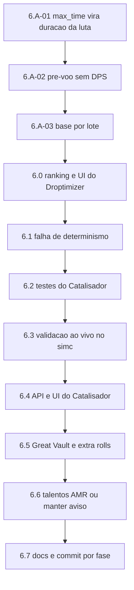

# Plano de Continuidade — Catalisador, Great Vault e Talentos AMR

**Criado em:** 2026-11-08
**Para quem:** qualquer agente de IA ou desenvolvedor que **assuma o trabalho no meio**.
**Por que existe:** registrar visão, arquitetura, estado exato do código e o passo a passo
restante, de modo que a continuação não precise redescobrir nada nem refazer decisões.

> Leia as seções 1 a 4 antes de escrever qualquer linha. Elas contêm as regras que,
> se quebradas, invalidam o produto inteiro.

---

## 1. A visão do produto (palavras do usuário)

> "Um sistema que unificasse de forma complementar as strings do SimC e do AMR, que fosse
> independente e gratuito, e que servisse de simulador mais robusto que o AMR e o SimC,
> para eu fazer o **loadout completo** e o sistema calcular. Hoje nenhuma das duas
> plataformas faz o loadout completo com runas de Omnium Folio, Top Gear exclusivo de M+,
> Great Vault e extra rolls, **excluindo drops de raide**, mas considerando itens Míticos
> de qualquer parte para eu transformar em tier set via Catalisador, e que também
> comparasse possíveis árvores de talentos de maneira unificada."

Diferenciais frente ao Raidbots (que é a referência de mercado): roda local e sem fila,
tem estimativa instantânea por heurística, é PT-BR, lê SimC **e** AMR juntos, e explica a
decisão de cada troca.

### Escopo recortado (decisões já tomadas, não reabrir sem o usuário)

| Item | Decisão | Motivo |
| :--- | :--- | :--- |
| **Códice Corroído** | **Fora de escopo** | O SimC não modela esse sistema (busca em `simc-midnight/engine` por `corrosive` só acha o truque dos Vulpera). O usuário confirmou que "só funciona em Delve e mundo aberto". Sem modelo no SimC, qualquer número seria estimativa — proibido pela regra P1. |
| **Drops de raide** | Excluídos das pools | Pedido explícito: progressão No-Raid. As pools vêm de M+, Delve e craft. |
| **Simulador em GPU** | Arquivado | [`estudo-viabilidade-sim-gpu.md`](../../plans/estudo-viabilidade-sim-gpu.md) estima 5x a 32x, mas exigiria reimplementar o motor do SimC. Custo altíssimo, ganho não medido. |
| **"Todas" as árvores de talento** | Comparar um conjunto de candidatas | Testar o espaço completo é inviável e nenhum simulador faz. Valem os loadouts salvos no export + import strings extras. |

---

## 2. Invariantes do projeto (quebrar isto é bug grave)

1. **P1 — Só o SimulationCraft produz número.** Nenhum DPS pode vir de estimativa, de
   fórmula própria ou de LLM. A heurística de poda ([`heuristic/score.py`](../src/wowsim/heuristic/score.py:1))
   devolve *score*, nunca dano, e carrega `heuristico=True`.
2. **Sem inventar dado de jogo.** Nome, ilvl, `bonus_id`, `enchant_id` e regra de sistema
   saem de arquivo auditado em `dados/` ou do próprio `item_data.inc` do SimC. Tradução
   PT-BR "de cabeça" é proibida (pendência P-006 existe exatamente por isso).
3. **Toda pendência tem condição de fechamento.** Ver o padrão em
   [`PENDENCIAS.md`](../PENDENCIAS.md).
4. **Quebra de linha CRLF.** Os arquivos do repositório são Windows (CRLF). Script que
   reescreve arquivo **deve preservar** isso, senão o diff vira centenas de linhas falsas.
   (Aconteceu nesta sessão: 3.353 linhas de diff para 169 de mudança real.)
5. **Código e comentários em PT-BR** nas partes novas, seguindo o estilo já existente
   (docstrings explicam o *porquê*, não o *o quê*).
6. **Idioma do usuário é PT-BR.**

---

## 3. Arquitetura atual (mapa de 30 segundos)

```
C:\Users\carlo\Desktop\
├── Crawl4AI\                 scraper Wowhead (Crawl4AI + Streamlit + MCP)
│                             → github.com/carlosfylho-hub/Crawl4AI-WoW-Scraper (main)
└── Simulador WoW\
    ├── simc-midnight\        FONTE do SimulationCraft (build 12.1.5.70783) — 1,3 GB
    ├── wow-sim\              BACKEND Python: motor numérico  (~11,7k linhas + 4,9k testes)
    │                         → github.com/carlosfylho-hub/WoW-Simulator (master)
    ├── Simulator-WoW\        FRONTEND React 19 + Vite + Tailwind (~13k linhas TS)
    │                         → github.com/carlosfylho-hub/Simulator-WoW (main)
    └── plans\                auditorias e planos (este arquivo)
```

Um único processo serve tudo: o FastAPI do `wow-sim` serve o `dist/` do React e expõe a
API; `wowsim app` abre isso numa janela pywebview. Detalhe em
[`plano-unificacao-python-react.md`](../../plans/plano-unificacao-python-react.md).

### O caminho de um pedido de Top Gear

```
UI (TopGearPanel.tsx)
  → POST /api/topgear            (web/topgear_api.py)
  → fila SQLite                  (web/topgear_db.py)
  → worker                       (web/topgear_worker.py)
      ├── combinar_textos()      (parser/combinar.py)   SimC + AMR
      ├── construir_pools()      (topgear/pools.py)     candidatos por slot
      ├── construir_contexto()   (topgear/pools.py)     regras da spec
      └── executar_topgear()     (topgear/search.py)    busca em estágios
            └── criar_simulador()(topgear/runner.py)    .simc + profilesets
                  └── run_simc() (simc_runner.py)       binário real + cache
```

**Busca em estágios** (nunca produto cartesiano): poda heurística → varredura marginal →
montagem gulosa → **catalisador** → beam de 2 slots → encantos → gemas → talentos → Folio
→ consumíveis → refino com mais iterações. Cada etapa só aceita ganho acima do limiar de
erro (0,15%).

---

## 4. Como o Catalisador foi modelado (a ideia central)

Regra de jogo, registrada em `dados/season2_context.json`: o Catalisador converte uma peça
de armadura de **slot de tier** (cabeça, ombros, torso, mãos, pernas) na peça
correspondente do tier set do spec, **preservando trilha, nível de aprimoramento e stats
base** do item original.

No SimC isso se escreve exatamente como o addon já exporta uma peça catalisada:

```
head=,id=<ID_DA_PECA_DE_TIER>,bonus_id=<os mesmos do item original>,redirected_base_stats=<ID_DO_ITEM_ORIGINAL>
```

Confirmado na fonte: `redirected_base_stats` é parseado em
`simc-midnight/engine/item/item.cpp:875` e aplicado em
`engine/dbc/sc_item_data.cpp:1076` (o item de origem entra como `redirect_item` em
`parsed.data.init`). O bônus de 2/4 peças o SimC calcula sozinho a partir do `id_set` do
item equipado — **não existe** nada para implementar ali.

**Por que duas mecânicas e não uma:** o valor do tier vem do bônus de conjunto, que só
aparece com 2 ou 4 peças. A busca gulosa troca **um** slot por vez, então para quem tem 0
ou 1 peça de tier nenhuma troca isolada mostra ganho. Daí:

* **gêmeos catalisados** na pool — cada candidato de slot de tier ganha a versão
  catalisada, medida no contexto atual (resolve "falta 1 peça para o 2pc/4pc");
* **pacotes** — combinações de 2 e 4 peças a partir do melhor conjunto (resolve "tenho 0
  ou 1 peça"), onde nenhuma troca isolada apareceria.

---

## 5. Estado do código AGORA (o que já está feito)

Trabalho desta sessão, **ainda sem commit**. `git diff --stat --ignore-cr-at-eol` deve
mostrar **169 inserções e 10 remoções** em 7 arquivos, mais 4 arquivos novos. Se mostrar
muito mais, as quebras de linha foram corrompidas (ver invariante 4).

### Arquivos novos

| Arquivo | O que é |
| :--- | :--- |
| [`scripts/derivar_tier_sets.py`](../scripts/derivar_tier_sets.py:1) | Deriva as 5 peças de tier de cada classe lendo `id_set`, `class_mask` e `inventory_type` do `item_data.inc` do SimC. Regra: conjunto de 5 peças, qualidade Épica, máscara de classe única, de maior `item_id`. |
| `dados/derivados/tier_sets.json` | Saída do script. **13 classes** (set 2055 a 2067). Ex.: warlock = set 2066, head 271546, shoulder 271544, chest 271549, hands 271547, legs 271545 — confere com o fixture do Pyrogalth. |
| [`src/wowsim/data/tier.py`](../src/wowsim/data/tier.py:1) | Leitor com cache: `ConjuntoTier`, `normalizar_classe`, `conjunto_da_classe`, `ids_tier`, `disponivel`. Arquivo ausente ⇒ `{}` e o recurso simplesmente não liga. |
| [`src/wowsim/topgear/catalisador.py`](../src/wowsim/topgear/catalisador.py:1) | `gemeo_catalisado`, `adicionar_gemeos`, `pecas_de_tier`, `contexto_com_catalisador`, `pacotes_de_tier`. |

### Alterações em arquivos existentes

| Arquivo | Mudança |
| :--- | :--- |
`topgear/models.py` | `Candidato.redirected_base_stats` + propriedade `.catalisado`; `Estagio` ganhou `"catalisador"`; `TopGearRequest.catalisador` (bool, default **False**) e `.max_catalisados` (0–5, `None` = sem limite); `ContextoSpec.max_catalisados` e `.catalisados_equipados`.
`topgear/runner.py` | `_linha_item` emite `redirected_base_stats=` quando presente.
`topgear/search.py` | **(a) correção de bug:** `conjunto_do_personagem` passou a preservar `item.redirected_base_stats` — sem isso, toda peça **já catalisada** do personagem perdia os stats base ao ser reescrita, afetando Top Gear **e Droptimizer** (que importa a mesma função); **(b)** `_chave_conjunto` inclui o campo; **(c)** nova etapa `otimizar_catalisador`; **(d)** ligação em `executar_topgear` (gêmeos na pool + contexto + etapa na lista).
`topgear/pools.py` | `_chave` de deduplicação inclui `redirected_base_stats` (senão o gêmeo colidiria com o original).
`topgear/constraints.py` | `_erros_catalisador` (teto de cargas) entra em `validar`; `avisos` passa a relatar quantas conversões o conjunto usa, em quais slots, e explicita a premissa da regra.
`heuristic/score.py` | chave do `_dedupe` inclui `redirected_base_stats`.
`cli.py` | `wowsim topgear --catalisador` e `--max-catalisados N`.

### Verificações já feitas

* `import wowsim.topgear.search` e `import wowsim.topgear.catalisador` — OK.
* `tier.conjunto_da_classe('Warlock')` → set 2066 com os 5 ids corretos; `'death-knight'`
  normaliza; classe desconhecida → `None`.
* Subconjunto da suíte (constraints, pools, search, heuristic) rodou **62 passed, 1
  failed** — a falha é `test_topgear_search.py::test_busca_e_deterministica` e é
  **anterior** a estas mudanças (ver seção 6.1).

---

## 6. O que falta — passo a passo

### 6.A Auditoria do sistema — 2026-11-08 (achados, antes de corrigir)

Varredura feita a pedido do usuário, por classes de defeito: corretude numérica,
chave de cache, falhas silenciosas, concorrência, validação de API, contrato com
o frontend e qualidade dos testes. Cada achado traz evidência medida, não
suspeita. **Nada foi corrigido ainda** quando esta seção foi escrita.

---

#### A-01 — CRÍTICO — O tempo de parede vira a duração da luta

**O que acontece.** `run_simc` converte o seu `timeout` (limite de execução) em
`max_time` do simc:

```python
# simc_runner.py
max_time_efetivo = max(1, int(timeout) - 2)   # quando max_time não foi dado
```

e `criar_simulador` define `timeout = orçamento restante`, ou **3600 s** quando
não há orçamento (caminho da CLI):

```python
# topgear/runner.py
timeout = max(1.0, restante) if restante is not None else 3600.0
```

**Por que está errado.** No SimulationCraft, `max_time` **não** é limite de
execução: é a **duração da luta simulada**. Na fonte:
`sim/sim.cpp:3802` declara `opt_timespan("max_time", ...)` e `sim/sim.cpp:1590`
define o padrão `max_time = 300_s`. O comentário no código do projeto diz o
contrário ("para o simc parar sozinho e ainda gravar o JSON"), e é dessa
confusão que nasce o defeito.

**Impacto medido**, lendo `options.max_time` e o DPS nos JSONs de
`cache/` — mesmo personagem, mesmo Patchwerk:

| Duração da luta | DPS medido |
| --: | --: |
| 15 s | **351.323** |
| 28 s (pré-voo) | 349.522 |
| 118 s | 216.621 |
| 300 s (padrão do simc) | 199.725 |
| 490 s | 147.164 |
| 598 s | 143.412 |
| 3598 s (CLI sem orçamento) | 188.451 |

**2,4x de diferença** no mesmo perfil, vindo só do relógio. Pior: como o
orçamento drena a cada rodada, a duração **muda entre rodadas** — o log real do
usuário mostra `max_time` indo de 597 → 579 → 578 → 561 → 452 → 449 → … → 336.
A base é medida numa duração e os candidatos em outra, então **o delta entre
rodadas do Top Gear compara coisas diferentes**.

**O que escapa.** `DungeonSlice` e `DungeonRoute` forçam `max_time = 360`
internamente (`sim/sim.cpp:2349`), então sobrescrevem o valor que mandamos. Foi
sorte: o cenário que o usuário mais usa (M+) estava protegido. **Patchwerk, que
é o cenário padrão de `TopGearRequest` e `DropRequest`, não está.**

**Efeito colateral.** `max_time` entra na chave de cache. Como ele muda a cada
segundo de orçamento, a chave muda junto: há **26 valores distintos** de
`max_time` no cache atual, ou seja, quase nenhum reaproveitamento entre
execuções. Corrigir isto também conserta o cache.

**Correção proposta.** Parar de derivar `max_time` do `timeout`. A proteção de
tempo de parede já existe e é outra: `Popen` + `timeout` + matar o processo.
`max_time` deve ser ou o padrão do simc (não passar nada) ou um parâmetro
explícito e **constante** por cenário, nunca função do relógio.

**Aceite.** (a) Nenhuma chamada passa `max_time` derivado de `timeout`; (b) dois
jobs do mesmo perfil, com orçamentos diferentes, produzem a **mesma** chave de
cache e o mesmo DPS; (c) teste que falha se `max_time` virar função de `timeout`;
(d) revalidar os números de aceite do `simc-check` no README, que podem ter sido
medidos com duração errada.

---

#### A-02 — ALTO — O DPS do pré-voo é exibido e está inflado

`preflight()` roda com `iterations=5` e `timeout=min(30, orçamento)`, o que pela
A-01 vira uma luta de ~28 s. O DPS que sai dali (~349.000 no exemplo acima) é
reportado como progresso e aparece na interface, enquanto o valor real do mesmo
perfil é ~200.000. No log do usuário o pré-voo deu 144.688, depois 132.106,
depois 141.174 para o mesmo personagem — variação de 9% que parece instabilidade
do simulador, mas é só a luta curta com 5 iterações.

**Correção proposta.** O pré-voo existe para responder "o simc roda este perfil
sem travar?". Deve devolver ok/falhou e duração, e **não** publicar DPS como se
fosse medição. Se exibir algo, rotular como verificação, nunca como DPS.

**Aceite.** A UI não mostra número de DPS vindo do pré-voo.

---

#### A-03 — MÉDIO — Deltas entre lotes usam a base do primeiro lote

`_simular_em_chunks` divide o lote em partes, cada uma uma execução do simc, e
guarda `base_dps` **só da primeira**:

```python
if base_dps is None:
    base_dps = leitura.base_dps
```

Cada execução mede a base de novo, com RNG diferente (~0,5% de erro). Os
candidatos da parte 2 em diante são comparados com a base da parte 1, somando ao
delta um ruído da ordem do próprio limiar de aceitação.

**Correção proposta.** Calcular o delta de cada candidato contra a base **da sua
própria execução**, ou medir a base uma vez e reusá-la explicitamente, deixando
claro qual foi usada.

**Aceite.** Teste com simulador falso em que as bases dos lotes diferem e o
delta de cada candidato sai correto contra a sua própria base.

---

#### A-04 — MÉDIO — Quatro cenários diferentes produzem a mesma simulação

Em `estilo_de_luta`, `raid`, `mplus`, `cleave_aoe` e `delve_rooms` mapeiam todos
para `DungeonSlice`, e `delve_boss` para `Patchwerk`. A interface oferece essas
opções como se fossem distintas; escolher "Raid" ou "M+" dá exatamente o mesmo
número. Não é bug de cálculo, é promessa falsa na interface. (Todos os nomes de
fight style usados existem no simc — conferido em `util/util.cpp:545`.)

**Correção proposta.** Ou reduzir as opções ao que de fato difere, ou marcar na
UI quais são equivalentes hoje.

---

#### A-05 — BAIXO — Nome de arquivo do `.simc` salvo não é sanitizado

`POST /api/topgear/{id}/perfil/salvar` monta o nome com `job_id[:8]` sem filtrar
caracteres. Hoje o id é um UUID vindo do banco e a rota devolve 404 antes disso
se não existir, então não é explorável; ainda assim, o CSV do Droptimizer já
sanitiza (`nome_do_arquivo`) e o `.simc` deveria fazer o mesmo, por simetria.

---

#### A-06 — BAIXO — `threads` entra na chave de cache

Resultado reproduzível pede isso (o número de threads muda os fluxos de RNG),
mas como `threads_para_job()` varia conforme a carga, a mesma simulação quase
nunca reaproveita o cache entre execuções. Decidir conscientemente: ou fixar as
threads por job, ou tirar da chave aceitando variação dentro do erro.

---

#### O que foi verificado e está correto

Registrado para a próxima pessoa não repetir o trabalho:

- **Rótulo da heurística:** a UI mostra "Estimativa rápida (heurística) · não é
  DPS · fonte: …". O invariante P1 está respeitado onde eu olhei.
- **SQL:** nenhuma consulta montada por interpolação de string; tudo parametrizado.
- **Segredos:** nenhuma chave de API no frontend nem em retorno de rota; as
  chaves vêm só de variável de ambiente.
- **Nomes de fight style:** todos existem no binário do simc.
- **Chave de cache:** inclui bytes do perfil, parâmetros e identidade do binário
  (tamanho e mtime) — o desenho está certo; o problema é o `max_time` dentro dela.
- **`except` amplos:** os nove existentes têm justificativa escrita e caem em
  fallback declarado; nenhum engole erro em silêncio.
- **Concorrência:** o semáforo `VAGAS_SIMULACAO` (padrão 1) serializa as
  simulações pesadas, o que resolve na prática o risco de oversubscription
  apontado em `auditoria-e-plano-melhorias.md` (A2).

---

#### A-07 — CRÍTICO — O parser do AMR lê valor absoluto onde o formato usa diferença

**O que acontece.** O export do AskMrRobot comprime os números por **diferença
acumulada**: cada campo guarda a diferença para o valor anterior, não o valor em
si. O parser do projeto lê tudo como absoluto.

**Fonte autoritativa.** `AskMrRobot/AskMrRobot-Serializer/AskMrRobot-Serializer.lua`,
função `appendItemsToExport` (linhas 751–870), instalada na máquina do usuário:

```lua
local prevItemId = 0
...
table.insert(itemParts, itemData.id - prevItemId)   -- o id é a DIFERENÇA
prevItemId = itemData.id
```

**Impacto medido.** Comparando com os ids verdadeiros do export do SimC do mesmo
personagem (`fixtures/pyrogalth.simc`), no mesmo momento:

| Leitura | Acertos |
| :--- | --: |
| Parser atual (absoluto) | **1 de 15** |
| Diferença acumulada | **15 de 15** |

O único acerto é o primeiro item, porque a cadeia começa em zero e ali a
diferença coincide com o valor. Exemplos do erro: ombro lido como `1` quando é
`271544`; arma como `11495` quando é `251156`; pescoço como `132` quando é
`273781`.

**Não é só o id.** Pela fonte, usam diferença: o id do item, `u` (upgrade),
`v` (level), `n` (tuning), `b` (cada bônus), `o` (origem do Catalisador),
`x`/`y`/`z` (gemas, com contador compartilhado), `e` (encantamento) e
`p`/`q`/`r` (relíquia). São absolutos: `s` (slot), `j`/`k` (stats de craft),
`l` (qualidade de craft), `d` (vínculo), `c` (marca de catalisado) e
`h` (discSpellId). Os contadores zeram a cada seção, e os itens vêm ordenados
por id crescente.

Decodificando assim, a validação contra o export do SimC dá **15/15 em ids,
15/15 em encantamentos, 15/15 em gemas e 14/15 em bônus** (a capa diverge em um
bônus; é item craftado e merece conferência à parte).

**Sintoma que já estava visível.** O modelo tem um campo `bonus_ids_negativos`,
criado para acomodar "bônus negativos" que apareciam no export. Bônus negativo
não existe: eram diferenças negativas. O campo deve desaparecer com a correção.

**Por que os testes não pegaram.** `tests/test_parser_amr.py::test_item_wrist_239648`
confere exatamente **um** item — o primeiro, o único que a leitura errada acerta.
Os outros 14 nunca foram comparados com fonte externa. Lição para a suíte: teste
de parser precisa confrontar uma **fonte independente** (aqui, o export do SimC
do mesmo personagem), não só a própria saída.

**Alcance.** Tudo que passa pelo AMR: os itens da mochila (`.inv`) usados pelo
Droptimizer, a combinação SimC + AMR (P-029) e qualquer execução com
`primario="amr"`. Como os ids não existem, o catálogo não os reconhece e os itens
somem ou entram sem atributos — silenciosamente.

**Correção proposta.** Reescrever a decodificação de `appendItemsToExport` em
`parser/amr.py` seguindo a tabela acima, remover `bonus_ids_negativos` e validar
contra o export do SimC.

**Aceite.** Teste que compara **todos** os 15 slots do fixture AMR com os ids,
bônus, gemas e encantamentos do `fixtures/pyrogalth.simc`, com 15/15 em ids.

---

#### A-08 — OPORTUNIDADE — O export do AMR já traz o Grande Cofre (`.gv`)

`appendItemsToExport` é a **mesma** função usada para `.inv` e para `.gv`
(serializer, linhas 1069–1078), e `Export.lua:219` mostra `scanGreatVault()`
lendo `C_WeeklyRewards.GetActivities()`. Ou seja: as opções do Grande Cofre vêm
no export que o usuário já cola, no formato idêntico ao da mochila.

Consequência: a entrada de dados da pauta "qual opção do Cofre pegar" — que eu
havia estimado como o trabalho mais chato, digitar 9 itens por semana — **sai de
graça** assim que A-07 for corrigido. O parser já separa a seção `.gv`; hoje ela
é lida e descartada sem uso.

No fixture atual `.gv` está **vazia** (0 caracteres), porque o export foi tirado
com o cofre sem opções. Confirmar com um export tirado após o reset semanal e
antes de coletar.

---

#### A-09 — OPORTUNIDADE — A tag `o` é a origem do Catalisador

`o` guarda `catalystSource`: o item que foi convertido para gerar aquela peça de
tier. É exatamente a informação que o `redirected_base_stats` do SimC carrega e
que o trabalho do Catalisador (§4) precisa. O export do usuário tem quatro:
`o251185`, `o22601`, `o-117436`, `o115881` (valores em diferença).

Com isso o sistema sabe, sem perguntar, quais peças **já foram** catalisadas e
não gastam carga nova.

---

#### A-10 — OPORTUNIDADE — A string de Best in Bags resolve a pendência P-016

A string que o AMR devolve para colar no addon é, na primeira metade, **um export
normal** no mesmo formato (`$181;...;.q2;...`) — o parser do projeto já a lê. A
segunda metade, depois do `$`, é um bloco de encantamentos:

```
@e\7935\240133\1228974\Int/Sta\251691=5,236950=6,...
   ^enchant  ^item   ^spell  ^nome   ^reagentes (item=qtd)
```

Isso dá, de graça, o mapa `enchant_id → item_id → spell_id → nome → materiais`,
incluindo as duas entradas que a pendência **P-016** pede explicitamente: a Arte
de Batalha Hash'ey (`8730 → 283998 → 1315084`) e a Magilinha de pernas
(`7935 → 240133 → 1228974`). A lista de reagentes ainda serve como lista de
compras, que o sistema hoje não tem.

**Ressalva de produto:** aproveitar o *bloco de encantamentos* é barato e é dado
novo. Já importar a *recomendação* do AMR (quais itens ele escolheu) tem pouco
valor: são itens que o usuário já possui, que o sistema já lê das duas fontes, e
a escolha do AMR vem do modelo dele, enquanto o sistema mede no SimC. O uso
honesto da recomendação é como **conjunto candidato a conferir**: medir, na mesma
execução, o conjunto do AMR contra o atual e contra o melhor do próprio sistema.

---

#### A-11 — Pawn: pouco a aproveitar

A pasta do addon (`AddOns/Pawn`) foi inspecionada: `ItemIDs.lua` são 32 linhas de
exceções, `Core.lua` é andaime de localização e `Gems.lua` traz recomendações de
gema que o projeto já cobre melhor com as 72 gemas raspadas e seus atributos.
Nada a importar.

A **string do Pawn** que o AMR gera (`Intellect=162.17, CritRating=79.84, ...`)
são pesos de atributo. O projeto já produz pesos **medidos** no SimC para o
perfil exato (`scripts/derivar_pesos.py` com `calculate_scale_factors`), que são
mais autoritativos. O único uso defensável é como fallback melhor que os pesos
curados genéricos quando ainda não há medição — importação de cinco linhas,
valor marginal.

---

#### A-12 — ALTO — Versatilidade some dos pesos medidos

`normalizar_scale_factors` ([`data/pesos_medidos.py`](../src/wowsim/data/pesos_medidos.py:45))
filtra as chaves por `SECUNDARIOS = ("haste", "crit", "mastery", "versatility")`,
mas o simc devolve **`Vers`**. Resultado no cache real do usuário
(`cache/752b8725be1361d8a9eb4bce.json`):

| simc | Int | SP | Crit | Haste | Mastery | **Vers** |
| :-- | --: | --: | --: | --: | --: | --: |
| scale factor | 64,4 | 60,0 | 47,3 | 31,7 | 42,8 | **36,7** |

O arquivo salvo (`cache/pesos/c55b24e2d6a58730.json`) tem só crit, haste e
mastery: a versatilidade é tratada como zero pela poda heurística. Qualquer que
seja a ordem real, zero está errado — o próprio AMR dá Aceleração 66,9 e
Versatilidade 65,3 para este personagem.

**Correção de uma conclusão anterior.** Esta seção chegou a afirmar que, para
este personagem, versatilidade vale mais que aceleração. **Isso estava errado**
e foi apontado pelo usuário: a afirmação vinha de uma única medição inválida. O
guia do próprio projeto (`dados/demonology_warlock.json`,
`prioridade_atributos_secundarios`) põe **Aceleração em 1º** e Crítico em 2º.

**O problema maior que isso revela.** A medição pôs a aceleração em **último**,
contradizendo o guia. Ela foi feita com `timeout=120` (luta de **118 s** pela
A-01) e só **69 iterações**, sem margem de erro registrada. Em luta curta domina a
abertura com recargas e o valor da aceleração na economia de Estilhaços não
aparece. Como **esses pesos alimentam a poda do Top Gear** (crit 1,0, mastery
0,90, haste 0,67), o sistema provavelmente vem descartando itens de aceleração
antes de simular — o oposto do desejado. Mais grave que a versatilidade sumida.

**Até haver medição válida, os pesos medidos não devem ser usados na poda**; o
fallback deve ser a ordem do guia ou os pesos curados. Medição válida = luta de
duração correta (300 s ou DungeonSlice), milhares de iterações, margem de erro de
cada fator guardada junto. Se a medição válida ainda divergir do guia, investigar
a causa antes de confiar em qualquer um dos dois.

**Correção:** mapear `Vers → versatility` (e `Int`, `SP` quando úteis), medir com
luta de duração correta, por cenário, com iterações suficientes, e guardar o erro
de cada fator (o simc o publica).

---

#### A-13 — PROPOSTA — Exportar string do Pawn com pesos medidos pelo sistema

**Formato** (exemplo que o usuário colou, gerado pelo AMR):
`( Pawn: v1: "Pyrogalth - Demonology": Class=Warlock, Spec=Demonology,
Intellect=162.17, CritRating=79.84, MasteryRating=71.52, HasteRating=66.92,
Versatility=65.25 )`.

**O que o sistema faria melhor:** pesos tirados de `calculate_scale_factors` do
SimC **para o personagem exato** e **por cenário** — uma escala de M+
(DungeonSlice) e outra de alvo único — em vez de um número único do modelo do AMR.

**Limite honesto, para constar na tela:** Pawn é linear. Não enxerga bônus de
tier, procs, efeitos de berloque nem breakpoints. Serve para o tooltip do jogo dar
uma primeira indicação; decisão continua sendo simulação.

**Pré-requisitos:** A-01 e A-12. Hoje os pesos do sistema são **piores** que os do
AMR (luta de 118 s, 69 iterações, sem versatilidade).

**Esforço:** pequeno. `derivar_pesos_medidos` já roda o cálculo; falta a fórmula
de saída e um botão. **Aceite:** string aceita pelo Pawn no jogo, um perfil por
cenário, com a duração da luta e as iterações registradas no nome ou na nota.

---

#### A-14 — PROPOSTA — Exportar string do AMR com o conjunto do sistema

**Viável.** `Import.lua:305` valida só versão, nome e nível do personagem. Os
itens são encontrados por **semelhança** (`Gear.lua:24`, `countItemDifferences`:
id, bônus, gemas, encanto); o `guid` é opcional e só pesa se os dois lados o
tiverem. Ou seja, uma string montada pelo sistema, sem `guid`, faz o addon apontar
no jogo quais itens equipar e quais gemas e encantos aplicar — com o conjunto
**medido pelo SimC**, não o escolhido pelo modelo do AMR.

**Formato:** o mesmo de A-07 (diferença acumulada, `appendItemsToExport`) seguido
de `$` e do bloco de extras (`@<setupId>#_@<rótulo>@e\...`). Várias montagens
vão em linhas separadas, com `_bib_` na primeira linha (`Import.lua:316`).

**Riscos:** formato sem documentação, pode mudar a cada versão do addon; um erro
de codificação faz o addon recomendar o item errado em silêncio. Mitigação
obrigatória: teste de ida e volta — codificar o conjunto, decodificar com o
decodificador validado em A-07 e exigir igualdade item a item.

**Pré-requisitos:** A-07 (é a mesma especificação, no sentido inverso).

**Esforço:** médio, 1 a 2 dias.

---

#### Ordem sugerida de correção

1. **A-01** e **A-07** — os dois que invalidam dado. Sem eles, nenhum número de
   Patchwerk e nenhum item vindo do AMR são confiáveis.
2. **A-02** — barato e evita que o usuário desconfie do simulador à toa.
3. **A-08** e **A-09** — caem no colo depois de A-07 e destravam o Cofre e o
   Catalisador sem trabalho de interface.
4. **A-03** — precisão dos deltas em pools grandes.
5. **A-10** — bloco de encantamentos do AMR; fecha P-016.
6. **A-04**, **A-05**, **A-06** — honestidade da interface e higiene.


### 6.B Requisitos refinados pelo usuário — 2026-11-08 (substitui o desenho das três perguntas)

O usuário reorganizou o produto. Registro fiel do pedido e do desenho que o atende.

#### Pilar principal — onde gastar o bonus roll (com o Catalisador embutido)

**Pedido, nas palavras dele:** sugerir peças de várias masmorras e ordenar as
masmorras pela chance de cair algo que fortaleça a build ("Altar das Presas tem 7
itens que servem para você"); mostrar as 5 melhores; mostrar **o % de upgrade de
cada item**, porque uma masmorra com menos itens pode ter um colar que sozinho vale
2% a mais que qualquer outro. A decisão de arriscar na masmorra com mais itens ou
na que tem o maior item é **dele** — o sistema mostra as duas coisas, não escolhe.
Peças que viram tier pelo Catalisador **entram na conta** e o sistema **explica**:
"estes 5 são para catalisar, estes 2 são upgrade direto".

**Desenho:**

1. Pool = itens de M+ que a classe/spec pode usar (armadura do tipo certo, atributo
   primário certo, joias, berloques de conjurador, armas). O jogo filtra o loot pela
   spec de saque, então esse é o denominador correto. Hoje: 5 a 9 itens por
   masmorra para Warlock (tecido + joias + armas + berloques).
2. Nível do item = parâmetro (o nível que ele vai receber, conforme a chave que
   roda). Muda o ranking, então fica visível na tela.
3. Cada item é medido no seu slot contra o equipado. Se for slot de tier e não for
   tier, mede também a versão catalisada. O item recebe uma etiqueta:
   - **upgrade direto** — ganho sem converter;
   - **para catalisar** — o ganho só aparece convertido (fecha 2pc/4pc);
   - **os dois** — ganha cru e ganha mais convertido;
   - **não serve** — ganho dentro do erro ou perda.
4. Por masmorra: **quantos itens servem**, de quantos elegíveis (ex.: 7 de 9),
   **o maior ganho** e **a lista completa com o % de cada item** e a etiqueta.
5. Ordenação padrão: por quantidade de itens que servem; o usuário troca para "maior
   ganho" com um clique. Mostrar as 5 primeiras, com as demais recolhidas.
6. "Chance" exibida = itens que servem ÷ itens elegíveis da masmorra, com a
   premissa escrita na tela: cada item elegível com a mesma chance de cair. É
   suposição declarada, não medição — o ganho de cada item é que é medido.
7. Tudo numa única execução do simc por montagem (base + todos os itens), com
   triagem em poucas iterações e refino com milhares nos que passarem.

**Lacunas de dado:** berloques têm a masmorra na chave da seção, não no item
(recuperar pela estrutura); o banco não tem o chefe — a granularidade é masmorra.

#### Camada transversal — várias árvores de talento e specs

**Pedido:** embutir várias árvores de talento ou specs; o sistema calcula quais
itens são melhores **por árvore** e o usuário monta o loadout completo de cada uma.

**Viável com o SimC**, e o insumo já existe: o export do SimC traz loadouts salvos
com nome — no fixture: *raid maxroll*, *Diabolist Delves*, *m+ icy*, *delves icy*,
*Diabolist Single*, *single icy* — e o parser já os lê. O AMR não serve de motor
(não tem API); os talentos dele também não são convertidos (P-012), então a fonte
das árvores é o export do SimC, mais strings coladas pelo usuário.

**Desenho:**

1. O usuário marca quais loadouts comparar.
2. Para cada loadout, roda o pilar principal com aquele `talents=` — uma execução
   por loadout, base e candidatos no mesmo arquivo.
3. Saída em matriz: **item × loadout**, com o % em cada coluna. Mostra o que é bom
   em todas as builds (aposta segura) e o que só serve numa.
4. **Loadout completo por build:** melhor peça por slot (entre o que ele tem e o que
   escolheu buscar) e **uma execução de confirmação** do conjunto montado, para
   pegar efeitos de combinação (tier, dois berloques de uso, embelezamentos). Não
   reativa o Top Gear com beam/estágios — é montar e confirmar.
5. Outra spec (ex.: Destruição): mesmo mecanismo trocando `spec=` e a árvore. Para
   Warlock o atributo primário é o mesmo, então o pool é igual; armas podem diferir.

**Custo:** multiplica o tempo pelo número de loadouts. Com triagem + refino, alguns
minutos por loadout. Mostrar a estimativa antes de rodar.

#### Grande Cofre

Inalterado: entra pelo `.gv` do AMR após A-07 e usa as mesmas etiquetas
(direto / para catalisar). Pode rodar por loadout também.

### 6.0 Correções do ranking e da UI do Droptimizer (P0 — EM ANDAMENTO)

Origem: o usuário rodou o Droptimizer real (Druida Equilíbrio, DungeonSlice, 200
iterações, 103 candidatos) e relatou quatro problemas na tela — botão "Baixar CSV"
sem efeito, sem ícone, sem tooltip e itens repetidos com o mesmo nome. A
investigação achou um quinto, mais grave, que ele não citou.

#### O defeito grave: o ranking marcava "empate" em tudo

`_KEYS_ERRO` em [`simc_runner.py`](../src/wowsim/simc_runner.py:1) escolhia
`std_dev`/`stddev` — a **dispersão entre lutas individuais** (3% a 7% da média) —
em vez de `mean_error`/`mean_std_dev`, que é a **incerteza da média** (~0,5%). Esse
valor alimenta `_limiar_por_erro`, então o piso de aceitação ficava ~7x maior que o
real e engolia qualquer ganho.

Evidência, medida no JSON real da execução do usuário
(`cache/cf7b901bbb77814c3a37baf4.json`, 103 profilesets):

| Métrica | Valor |
| :--- | --: |
| Ganhos reconhecidos com o código antigo (`stddev`) | **0 de 103** |
| Ganhos reconhecidos com `mean_error` | **32 de 103** |
| Limiar no candidato de +3,60% — antes | 6,84% |
| Limiar no mesmo candidato — depois | 0,95% |

Os dois blocos do simc usam vocabulário diferente, e é fácil errar: em
`collected_data.dps` o certo é `mean_std_dev`; num profileset é `mean_error`
(intervalo de confiança, = 1,96 × `mean_stddev`). **Nunca** `std_dev`/`stddev`.
Afeta também o Top Gear, que compartilha `_limiar_por_erro`.

#### Diagnóstico dos quatro problemas relatados

| # | Sintoma | Causa |
| :-: | :--- | :--- |
| 1 | "Baixar CSV" não faz nada | O botão monta um `blob:` e chama `link.click()`. A janela do app desktop é pywebview/WebView2 criada sem gerenciador de download ([`web/desktop.py`](../src/wowsim/web/desktop.py:104)), então o clique não gera arquivo nem erro. Mesmo padrão existe no TopGearPanel (download do `.simc`), provavelmente igual de quebrado. |
| 2 | Sem ícone | `DropRankingItem` não tinha campo de ícone. O backend já sabe o ícone (`catalog.visual_item`), mas não enviava. |
| 3 | Sem tooltip | `WowItemTooltip` + `TooltipContext` existem e o TopGearPanel já os usa; a tabela do Droptimizer nunca foi ligada neles, e faltavam `stats`/`nome_en` no payload. |
| 4 | Itens repetidos | Anel e berloque ocupam dois slots, então o mesmo item é medido em `trinket1` e `trinket2` e virava duas linhas idênticas na tela. |

#### Já feito (backend) — sem commit ainda

| Arquivo | Mudança |
| :--- | :--- |
| `src/wowsim/simc_runner.py` | `_KEYS_ERRO = ("mean_error", "mean_std_dev", "mean_stddev")`. Sem chave de erro da média, o erro fica `None` e o limiar cai no piso fixo de 0,15% — conservador, em vez de inflado. |
| `src/wowsim/droptimizer/models.py` | `DropRankingItem` ganhou `nome_en`, `icone`, `stats` e `slots_testados`. |
| `src/wowsim/droptimizer/search.py` | Preenche esses campos a partir do catálogo; nova `_agrupar_equivalentes`, aplicada antes da ordenação. |
| `src/wowsim/droptimizer/export.py` | **novo** — `gerar_csv`, `nome_do_arquivo`, `salvar_csv`. CSV com `;` e vírgula decimal, gravado com BOM (Excel PT-BR abre sem importação manual). |
| `src/wowsim/web/drop_api.py` | `GET /api/droptimizer/{id}/csv` (conteúdo) e `POST /api/droptimizer/{id}/csv` (grava em `saida/` e devolve o caminho). |
| `tests/test_droptimizer_ranking.py` | **novo** — 15 testes: erro da média vs dispersão, o caso +3,6% deixando de ser empate, agrupamento (inclusive `worst_in_bags` e item sem id) e CSV. |

**Decisão de produto sobre o CSV:** o backend grava o arquivo e a UI mostra o
caminho, em vez de tentar um download pelo navegador embutido. É o único caminho
que funciona tanto no app desktop quanto no navegador, e nunca falha em silêncio —
que foi exatamente a queixa.

**Decisão sobre o agrupamento:** a pergunta do usuário é "vale a pena usar este
item?", e a resposta é o melhor dos slots. A linha guarda o vencedor e
`slots_testados` registra onde ele foi medido, então nenhuma medição some. Itens
de ilvl diferente continuam em linhas separadas, porque são itens diferentes.

#### O que falta

1. ~~**Teste do endpoint CSV**~~ — **RESOLVIDO.** Falhava com
   `sqlite3.OperationalError: disk I/O error`. Causa: `db`, `perfil_store` e
   `topgear_db` fazem `from .db import DB_PATH`, então **cada módulo tem o seu
   objeto** — trocar só `db.DB_PATH` deixava o worker abrindo o banco real no
   startup. O teste agora troca os três. Armadilha geral desta base: ao isolar o
   banco num teste, patchear `db`, `perfil_store` **e** `topgear_db`.
   15/15 verdes em `tests/test_droptimizer_ranking.py`.
2. ~~**Frontend do Droptimizer**~~ — **FEITO.** Em `DroptimizerPanel.tsx`:
   ícone por linha e tooltip no hover (reaproveitando `iconeDoItem`,
   `bordaDoItem` e `showTooltip` do `TooltipContext`, o mesmo padrão do
   TopGearPanel); botão agora **"Salvar CSV"**, chamando
   `POST /api/droptimizer/{id}/csv`, com estado de carregando, caminho salvo em
   verde e erro em vermelho — nunca mais falha em silêncio; marcador
   "+N slots" quando o item foi medido em mais de um slot; campos novos em
   `dropService.ts` (`nome_en`, `icone`, `stats`, `slots_testados`,
   `DropCsvSalvo`, `salvarCsvDrop`).
3. **Conferir o efeito no Top Gear** — PENDENTE, exige o simc no Windows. Ele usa
   o mesmo `_limiar_por_erro`, então etapas que antes rejeitavam ganhos reais
   passam a aceitá-los; falta quantificar. **Aceite:** rodar
   `wowsim topgear fixtures\pyrogalth.simc` e registrar aqui o DPS final e o
   número de trocas aceitas, comparando com a execução anterior do usuário
   (base 144.688 → melhor 164.588, 3 trocas, 22 rodadas).
4. ~~**Mesmo defeito de download no TopGearPanel**~~ — **FEITO.** Novo
   `POST /api/topgear/{id}/perfil/salvar` grava o `.simc` em `saida/`; o botão
   virou "Salvar .simc" e mostra o caminho. Coberto por
   `tests/test_topgear_api.py::test_salvar_perfil_grava_arquivo`.
5. **README, PENDENCIAS e commit** — a suíte já está em **338 passed** com
   `-m "not integration_simc"`; restam só as 3 falhas de `Exec format error`
   (binário Windows em Linux). `tsc --noEmit` limpo.

#### Nota sobre o ambiente (Linux, acesso remoto)

- O `tsc` do projeto é o binário do Windows e não roda aqui. Solução usada:
  `npm install typescript@5.9.2` numa pasta fora do projeto e rodar
  `~/tscheck/node_modules/.bin/tsc --noEmit -p tsconfig.json`.
- `tests/test_simc_runner.py::test_read_results_base_e_profilesets` usava
  `median_std_dev`, chave que a saída real do simc **não** produz. A fixture foi
  corrigida para o vocabulário real (`mean_std_dev` na base, `mean_error` e
  `mean_stddev` no profileset) e passou a afirmar o erro lido.


### 6.1 Falha pré-existente de determinismo (P0, investigar antes de prosseguir)

`tests/test_topgear_search.py::test_busca_e_deterministica` compara duas execuções e
acusa diferença **só em `rodadas`** (os conjuntos e o DPS batem). Suspeita: ordem de
iteração ou contagem de candidatos variando entre execuções, o que muda `Rodada.candidatos`
sem mudar o resultado.

* Rodar `pytest tests/test_topgear_search.py::test_busca_e_deterministica -vv` e comparar
  as listas `rodadas` lado a lado.
* Confirmar se a falha já existia antes das mudanças desta sessão:
  `git stash && pytest ... && git stash pop`.
* **Aceite:** teste verde, ou pendência registrada em `PENDENCIAS.md` com causa raiz.

### 6.2 Testes do Catalisador (P0)

Criar `tests/test_topgear_catalisador.py`, offline (sem binário do simc), cobrindo:

1. `gemeo_catalisado` devolve a peça de tier do slot, com `redirected_base_stats` = id de
   origem e **os mesmos `bonus_ids`** (trilha preservada).
2. Recusa (`None`) para: slot sem tier (`wrist`, `neck`, `trinket1`), item que **já é**
   de tier, item já catalisado, `item_id=None`, item craftado.
3. `adicionar_gemeos` não duplica e não mexe em slot fora de `SLOTS_TIER`.
4. `pacotes_de_tier`: com 0 peças equipadas gera combinações de 2 e de 4; com 3 peças
   gera só o que falta para 4; respeita `travados`; classe sem dados → `{}`.
5. `constraints.validar` barra conjunto acima de `max_catalisados` e **não** conta peça
   que já estava equipada catalisada (não gasta carga).
6. `runner._linha_item` emite `redirected_base_stats=` na posição certa.
7. **Regressão do bug:** `conjunto_do_personagem` preserva `redirected_base_stats` de uma
   peça já catalisada. No fixture do Pyrogalth quem tem o campo é `chest=`
   (`redirected_base_stats=272231`) e `legs=` (`273786`), não `head=`.
8. `otimizar_catalisador` com simulador falso: escolhe o pacote de maior DPS e só aceita
   acima do limiar.

**Aceite:** suíte inteira verde (`pytest -q`) e os novos testes cobrindo os 8 pontos.

### 6.3 Validação ao vivo com o simc real (P0, exige Windows)

Só roda na máquina do usuário, com `bin/simc.exe` presente.

```bat
cd "C:\Users\carlo\Desktop\Simulador WoW\wow-sim"
.venv\Scripts\activate
wowsim topgear fixtures\pyrogalth.simc --catalisador --iterations-triagem 200 --orcamento 900
```

* **Aceite 1:** o `.simc` gerado contém pelo menos uma linha
  `...,id=2715xx,...,redirected_base_stats=<id original>` e o simc **não** reclama.
* **Aceite 2:** o relatório do simc mostra o bônus de conjunto ativo quando o pacote tem
  2 ou 4 peças (procurar o nome do set no HTML/JSON de saída).
* **Aceite 3:** o DPS do pacote de 4 peças é **medido**, não estimado.
* Se o simc ignorar `redirected_base_stats` em item de tier, registrar pendência e
  comparar com o comportamento do item já catalisado do próprio fixture (`head=271546`,
  que tem `redirected_base_stats` no export real — é o controle).

### 6.4 API e UI do Catalisador (P1)

O `TopGearRequest` já aceita os campos (Pydantic), então a API funciona por tabela. Falta:

1. **Estimativa de custo:** `GET /api/topgear/estimativa`
   ([`web/topgear_api.py`](../src/wowsim/web/topgear_api.py:110)) não conta os
   gêmeos nem os pacotes. Com o Catalisador ligado, o número de profilesets cresce
   (até +5 gêmeos por slot de tier, mais as combinações de 2 e 4). Corrigir para o usuário
   não estourar o orçamento sem aviso.
2. **TypeScript:** adicionar `catalisador?: boolean` e `max_catalisados?: number | null` em
   `TopGearRequest` de
   [`Simulator-WoW/src/services/topGearService.ts`](../../Simulator-WoW/src/services/topGearService.ts:97).
3. **Painel:** em
   [`TopGearPanel.tsx`](../../Simulator-WoW/src/components/TopGearPanel.tsx:1), um checkbox
   "Catalisador (converter em tier)" + campo numérico de cargas, com `InfoTip` explicando
   que a conversão preserva trilha e stats. Persistir com `usePersistedState` (padrão já
   usado no painel).
4. **Resultado:** na tabela de trocas, deixar claro quando a peça é catalisada. O
   `nome_pt` do gêmeo já vem como `"<Peça de tier> (catalisado de <item original>)"`.
5. **Aceite:** `tsc --noEmit` limpo; job criado pela UI com o checkbox ligado volta com
   `rodadas` contendo o estágio `catalisador`.

### 6.5 Great Vault e extra rolls (P1 — a próxima peça da visão)

**Natureza do problema:** são itens que o usuário **ainda não tem**. A Great Vault oferece
9 opções e ele escolhe **uma**; extra roll é a mesma forma. Não é pool de itens possuídos,
é "escolha 1 entre N hipotéticos". O produto certo não é só o melhor conjunto: é o
**ranking das opções**, para decidir o que pegar.

Desenho proposto (não implementado):

1. **Modelo** — novo `src/wowsim/topgear/vault.py`:
   ```python
   class OpcaoVault(BaseModel):
       slot: str
       item_id: int
       ilvl: int                 # 321 / 334 / 341 ...
       bonus_ids: list[int] = []
       origem: Literal["great_vault", "extra_roll"] = "great_vault"
   ```
2. **Pedido** — `TopGearRequest.vault: list[OpcaoVault]` (máx. ~12) e
   `vault_max_escolhas: int = 1`.
3. **Restrição** — em `constraints.py`, barrar conjunto com mais de
   `vault_max_escolhas` itens de `fonte` começando com `vault:`. Mesmo formato do teto de
   embelezamentos.
4. **Etapa** — `otimizar_vault`, logo **antes** do Catalisador, para que uma peça Mítica
   vinda do Vault também possa ser catalisada (composição das duas features: é exatamente
   o "item mítico de qualquer parte viro tier" do pedido). Cada opção é testada contra o
   melhor conjunto atual; o resultado guarda o DPS medido de **cada** opção.
5. **Entrega** — `TopGearResult` ganha `ranking_vault: list[...]` com a opção, o delta
   medido e se ela depende de catalisar. A UI mostra "pegue X: +2,1%".
6. **Marcação obrigatória** — item de Vault é hipotético. O relatório tem de separar
   "ganho que depende de escolher X no Vault" do ganho com o que o usuário já possui.
   Nunca apresentar os dois somados como se fossem a mesma coisa.
7. **Aceite:** com 9 opções informadas, o job devolve as 9 medidas e ordenadas; conjunto
   com 2 itens de Vault é recusado pelo validador; teste offline cobrindo os dois casos.

**Fonte dos candidatos:** `dados/mplus_loot_database.json` (loot de M+ por masmorra) e
`dados/delve_loot_kindojan.json` (Delve). O usuário informa o que apareceu na Vault dele;
a UI pode oferecer um seletor por slot a partir dessas listas. Nada de inferir a Vault.

### 6.6 Talentos do AMR → import string do SimC (P2)

Pendência **P-012**. Hoje o parser do AMR guarda o blob cru (`.s2`/`.s3`) e emite o aviso
`amr_talentos_nao_convertidos` ([`parser/amr.py`](../src/wowsim/parser/amr.py:580)),
mantendo o loadout do SimC. Isso é **correto e seguro**: não há decodificação confiável.

Para fechar:

1. Investigar se `dados/amr_mapa.json` (gerado de `AskMrRobot-Serializer.lua`) tem a
   tabela de talentos. **Hoje tem apenas** `_meta` e `versoes` — pelo que se vê, specs,
   raças, facções e slots, **não** nós de talento.
2. Se não tiver, o caminho é extrair do addon do AMR o mapa de nó → `spellId` e montar a
   import string no formato do SimC. Trabalho considerável e com risco de erro silencioso.
3. **Alternativa de custo baixo, recomendada primeiro:** manter o aviso e deixar o usuário
   colar as import strings na aba Top Gear (campo `talentos_extra` **já existe** e já é
   simulado). Resolve 90% do caso de uso — "comparar árvores de maneira unificada" — sem
   risco de talento errado.
4. **Aceite:** teste de round-trip com `fixtures/pyrogalth-amr-181.txt`, ou decisão
   registrada em `PENDENCIAS.md` de manter o aviso.

### 6.7 Documentação e commit (fazer junto com cada fase)

* `README.md`: na seção do Top Gear, documentar a etapa `catalisador`, as flags da CLI e a
  premissa da regra do Catalisador.
* `PENDENCIAS.md`: fechar o que foi entregue (com evidência, no padrão da tabela) e abrir
  o que ficou.
* Commit com o rodapé de atribuição que a sessão estiver usando.

---

## 7. Comandos de validação

```bash
# na máquina do usuário (Windows), dentro de wow-sim
.venv\Scripts\activate
pytest -q                      # suíte inteira (265+ testes; parte é lenta)
pytest -q tests/test_topgear_catalisador.py -vv
python -m py_compile src/wowsim/topgear/catalisador.py
python scripts/derivar_tier_sets.py          # regenera dados/derivados/tier_sets.json

# frontend
cd ..\Simulator-WoW && npx tsc --noEmit

# enviar os 3 repositórios ao GitHub (duplo clique também funciona)
..\enviar_github.bat
```

Ambiente só para análise estática em Linux (sem o simc, que é `.exe`):

```bash
python3 -m venv ~/venv-wowsim
~/venv-wowsim/bin/pip install "pydantic>=2" pytest httpx fastapi uvicorn typer rich jinja2
cd wow-sim && PYTHONPATH=src PYTHONDONTWRITEBYTECODE=1 ~/venv-wowsim/bin/python -m pytest -q -p no:cacheprovider
```

---

## 8. Armadilhas desta base de código

1. **CRLF.** Reescreveu arquivo com script? Preserve as quebras de linha. Confira sempre
   com `git diff --stat --ignore-cr-at-eol` e compare com o `git diff --stat` normal.
2. **`.lock` do git.** Nas pastas do usuário acessadas remotamente, o git não consegue
   apagar os próprios arquivos temporários: sobra `.git/HEAD.lock` e comandos seguintes
   falham com "File exists". Renomeie o lock (`mv .git/HEAD.lock .git/stale-head-lock`),
   nunca dentro de `.git/refs`.
3. **`bin/simc.exe` não roda em Linux.** Qualquer validação de número é na máquina do
   usuário. Teste offline usa simulador falso.
4. **`cache/`, `wowsim.db`, `bin/` são ignorados** pelo `.gitignore` — não tente versionar.
5. **A suíte é lenta** (>200 s) porque parte roda simc real. A pendência A10 propõe marcar
   `slow`/`integration`.
6. **Não existe `../../WoW Calculator`.** Vários docs antigos apontam para esse repositório
   de dados, que não está nesta máquina. A fonte vigente é o snapshot `wow-sim/dados/`
   com `MANIFEST.json`.
7. **`redirected_base_stats` agora é parte da identidade de um candidato.** Se adicionar
   nova chave de deduplicação ou de cache em qualquer lugar, **inclua esse campo**, senão
   o gêmeo catalisado colide com o item original e um dos dois desaparece silenciosamente.

---

## 9. Ordem recomendada de execução



Entregue e faça commit **por fase**. O usuário relatou desânimo com fila infinita de
pendências; fase fechada e usável vale mais que três meio-prontas.
